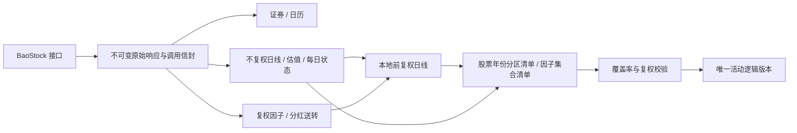

# 一期日行情数据模型

| 属性 | 内容 |
|---|---|
| 状态 | 采集、复权、质量门禁与发布已实现，在线验证范围见验收记录 |
| 修订日期 | 2026-11-24 |
| 范围 | A 股日线，历史目标从 2000 年起，BaoStock 为首个准入候选 |
| 实现基线 | 前向迁移 002/003、OpenAPI 0.3.0、Worker 信封 v1 |

## 1. 保存范围与边界

一期尽可能完整保存日行情相关数据：证券基础资料、交易日历、每日证券状态、
全部 18 个日 K 字段、三种复权因子、分红送转记录，以及每次接口调用的完整原始响应。
四项估值指标随日线一起采集，不再推迟到公司事实阶段。

标准化事实分为日线、估值、逐日状态、因子和公司行动五类。日线同时保留
`none` 与本地计算的 `qfq`，查询默认 `qfq`。完整财报、行业/指数成分、
分钟行情与新闻仍按后续阶段建设；日线中的估值比率不等于完整财报。

## 2. BaoStock 接口与采集策略

以下接口/字段依据官方 Python API 文档核验，属于供应商单源契约；
不代表已通过在线可用性、历史覆盖或 18:00 更新时点验收。

| 接口 | 保存字段 | 采集用途 |
|---|---|---|
| `query_stock_basic()` | `code, code_name, ipoDate, outDate, type, status` | 初始化全证券基础资料，保留退市证券；日更刷新并登记变化 |
| `query_trade_dates(start_date, end_date)` | `calendar_date, is_trading_day` | 显式获取完整目标区间日历，日更扩展区间 |
| `query_all_stock(day)` | `code, code_name, tradeStatus` | 补采/日更的当日证券集合、名称和交易状态，辅助核对日线与缺口 |
| `query_history_k_data_plus(code, fields, start_date, end_date, frequency="d", adjustflag="3")` | 下节全部 18 字段 | 按股票和日期范围历史补采、缺口修复；必须显式给日期和字段 |
| `query_daily_history_k_AStock(date)` | 下节全部 18 字段 | 全市场日更批次；SDK 必须先验证导出、字段及不复权口径，否则用单股接口实现同一标准模型 |
| `query_adjust_factor(code, start_date, end_date)` | `code, dividOperateDate, foreAdjustFactor, backAdjustFactor, adjustFactor` | 初始化完整因子集合；发现新事件/修订后重新拉取该股完整历史集合 |
| `query_daily_adjust_factor(date)` | 同上五字段 | 日更发现因子事件；可作为变化信号，不能代替单股完整集合刷新 |
| `query_dividend_data(code, year, yearType)` | 第 5 节全部分红日期、数值和描述 | 按股票、年份采集分红送转，保存 `report/operate` 查询口径及原始响应 |

基础证券表只纳入经证券类型、交易所、代码段核实的 A 股。`type=1` 表示
股票，不能单独证明是 A 股；`query_all_stock` 含指数，不能直接作为完整率分母。
不能只用今天的在市股票清单补采过去，否则会漏掉历史退市股票。

行情历史从 `max(2000-01-01, 上市日)` 起，截止目标 `as_of`，退市日期按供应商
语义确认后截断。因子需要更早的历史基准时，从上市日显式查询，不使用
`query_adjust_factor` 默认的 2015 年起点。分红查询覆盖相关历史年份，
`operate` 按除权年份，`report` 按预案公告年份；同一原始记录按内容哈希去重，
两种调用信封均保留。跨年方案与未实施方案不能仅按交易日期筛掉。

主数据原始 `type/status/outDate` 全部保留；标准表中的 `listed/delisted`
是转换结果。逐日名称通过状态记录留存，不以今天的名称覆盖过去。
原始快照保存每次观察到的主数据和日历，但当前主数据表并非完整的
point-in-time 证券版本模型。

## 3. 全部 18 个日 K 字段映射

SDK 0.9.4 实际字段如下，共 18 个；此前“19”是计数错误，未删减字段。

原始记录始终保存 SDK 字符串，包括空字符串和未知新增字段。
标准化日线以不复权 `adjustflag=3` 为基准：

| 原始字段 | 标准化位置 | 口径 |
|---|---|---|
| `date` | 各日级表 `trade_date` | ISO 交易日期 |
| `code` | `instrument_id` 解析；原始代码留存 | 如 `sh.600000` 转 `600000.SH`，绑定稳定内部 ID |
| `open` | `daily_bars.open` | 开盘价，人民币元 |
| `high` | `daily_bars.high` | 最高价，人民币元 |
| `low` | `daily_bars.low` | 最低价，人民币元 |
| `close` | `daily_bars.close` | 收盘价，人民币元 |
| `preclose` | `daily_bars.previous_close` | 不复权交易所前收参考价，除权日可能不同于上一条日线收盘价 |
| `volume` | `daily_bars.volume` | 成交股数，不换成手 |
| `amount` | `daily_bars.amount` | 当日真实成交额，人民币元，保留四位小数 |
| `adjustflag` | `daily_bars.adjustment` 与原始记录 | 基准记录仅接受 `3 → none`；本地生成 `qfq` |
| `turn` | `daily_bars.turnover_rate` | 来源百分数除以 100；`0.392500 → 0.003925` |
| `tradestatus` | 日线与 `instrument_daily_status.trade_status` | `1 → trading`，`0 → suspended` |
| `pctChg` | `daily_bars.change_rate` | 来源百分数除以 100；保留来源涨跌幅口径 |
| `peTTM` | `daily_valuations.pe_ttm` | 滚动市盈率 |
| `pbMRQ` | `daily_valuations.pb_mrq` | 最近报告期市净率 |
| `psTTM` | `daily_valuations.ps_ttm` | 滚动市销率 |
| `pcfNcfTTM` | `daily_valuations.pcf_ncf_ttm` | 滚动市现率，净现金流口径 |
| `isST` | 日线与 `instrument_daily_status.is_st` | 布尔；来源为空则未知 |

数据库 OHLC、`previous_close`、`amount` 统一用人民币元乘 `10000` 的 int64
整数；例如 `amount=1.2345` 保存为 `12345`，API 返回元。输入使用 Decimal
解析，不经过浮点再缩放；超精度、溢出及非法必填数值拒绝标准化。
本地复权运算在高精度 Decimal/有理数域完成，最终价格统一四舍五入到四位
小数并记录算法版本；已实现精确有理数与 ROUND_HALF_UP。

换手率、涨跌幅和估值标准列使用 REAL；完整原始十进制字符串仍可回查。
估值可为负值，不以“负值异常”丢弃。`previous_close/turnover_rate/change_rate/is_st`
及估值空值保存 NULL，不填零。缺少任一约定字段与“字段存在但值空”必须区分。
缺失 OHLC、量或额的记录保留原文并登记质量问题，不人为造出价格。
例外是来源明确 `tradestatus=0` 的不完整停牌占位行：保存逐日状态和可用估值，
不保存日线，非空数值仍验证。若该日已到主数据退市日期，状态记 `delisted`；
退市后的占位价格不作为合法成交日线。

`qfq` 只改变 OHLC；`previous_close`、`change_rate`、量额、换手率、ST 与估值
保持来源不复权口径。需要前复权上一条收盘价/收益时，从同版本 qfq 序列另行计算，
不能直接把 `previous_close` 当成 qfq 分母。

## 4. 事实表与逐日缺口

| 表 | 粒度 / 主键 | 内容 |
|---|---|---|
| `daily_bars` | 物理版本＋证券＋日期＋复权口径 | 全部价格、量额、比例、交易/ST 状态及原始快照引用 |
| `daily_valuations` | 物理版本＋证券＋日期 | 四种估值，只保存一份，不按复权口径复制 |
| `instrument_daily_status` | 物理版本＋证券＋日期 | 当日名称、交易/ST 状态、原因、观察时间和来源 |
| `adjustment_factors` | 因子物理版本＋证券＋生效日期 | 三个供应商因子、观察/发布时间和来源 |
| `corporate_actions` | ID；版本＋证券＋记录哈希唯一 | 分红送转各时间点、数值、说明及来源 |
| `data_quality_issues` | ID，关联逻辑版本/证券/日期 | 缺数、冲突、非法值、因子与复权差异 |

逐日状态枚举为 `trading/suspended/not_listed/delisted/missing`。
状态由日线、当日清单、上市退市日期和交易日历共同确定；日线和清单冲突时登记
问题，不能静默选一方。只有来源证据明确停牌才能记 `suspended`；
接口没返回股票不能直接认定停牌。

来源返回合法停牌日线时保留原样；来源只有停牌状态时，仅保存状态，不造日线。
未上市/已退市/缺失同样不填前一日价格。`is_suspended` 是交易状态的兼容派生字段。
非交易日由日历表达，不增加虚假的日线。`observed_at` 是本次观察时间，
来源无记录时对应 `source_snapshot_id` 可空，原因必须可追踪。

## 5. 因子与分红送转

### 5.1 复权因子

`dividOperateDate → effective_date`；三个因子原名分别对应
`fore_adjust_factor/back_adjust_factor/adjust_factor`，以十进制文本保存，
运算前验证有限且为正。保留三个字段，而非合并成含义不明的单个因子。
因子只在事件日出现，不要求每个交易日有一行；成功的完整区间空集合是合法结果，
需有零记录响应、请求范围和哈希作为证据。

BaoStock 使用涨跌幅复权算法，不能仅凭字段名假定任意一个因子乘价格就等于
前复权。接入时按官方算法说明、已锁定 SDK 和跨事件样本验证：
事件前后、无事件新股、停牌跨事件、历史修订及锚点变化。
本地结果与供应商 `adjustflag=2` 的抽样结果比较；供应商 qfq 样本也保存为
原始制品，不覆盖本地结果。允许误差按四位价格精度制定并写入算法契约，
未核验前不发布 qfq。

### 5.2 分红送转完整字段

| 原始字段 | `corporate_actions` 列 |
|---|---|
| `code` | 解析为 `instrument_id`，原始代码留存 |
| `dividPreNoticeDate` | `pre_notice_date` |
| `dividAgmPumDate` | `agm_announce_date` |
| `dividPlanAnnounceDate` | `plan_announce_date` |
| `dividPlanDate` | `implementation_announce_date` |
| `dividRegistDate` | `record_date` |
| `dividOperateDate` | `effective_date` |
| `dividPayDate` | `pay_date` |
| `dividStockMarketDate` | `stock_listing_date` |
| `dividCashPsBeforeTax` | `cash_per_share_before_tax` |
| `dividCashPsAfterTax` | `cash_per_share_after_tax_raw` |
| `dividStocksPs` | `stock_dividend_per_share` |
| `dividCashStock` | `description` |
| `dividReserveToStockPs` | `reserve_transfer_per_share` |

数值文本保留源精度；税后股利可能含多个税率对应值，完整保留字符串，
不擅自取某个值。未知日期为 NULL；尚无除权日期的预案仍可保存。
记录 `query_year/year_type/observed_at/source_snapshot_id/record_sha256`，
同日多方案不合并，修订进入新版本。查询年份与来源响应都可回查。

分红记录与因子分别存储：它们互相校验，但分红接口并非已证明完整的配股、
拆并股和全部公司行动库。因子匹配不上的记录要核查，不能用分红现金额自行
补造供应商因子。来源缺失真实历史发布时间时不伪造 `available_at`。

## 6. 原始响应与时间语义

每次调用完整保存到 `var/raw`，在 `artifacts` 登记相对路径、字节数、
SHA-256 和创建任务，在 `source_snapshots` 保存：

- `provider/operation/request_json/fields_json`：接口、全部请求参数、返回字段及顺序。
- `record_count/error_code/error_message`：成功/失败与空集合，不能只留成功记录。
- `fetched_at/provider_published_at/adapter_version`：获取时间、来源明确给出的发布时间、适配器版本。
- `artifact_id/dataset_version/as_of`：不可变原文和本次构建目标。

SDK 的所有原始行按字段顺序和原字符串保存，转换后的 `source_record` 也保留
未知新增字段。Worker/依赖锁版本在 attempt 清单中记录。失败/截断调用写审计，
不能把部分响应标成完整快照；信封计数/哈希正确也不代表领域校验已通过。

`trade_date/effective_date` 是事实日期；`fetched_at/observed_at` 是我们观察到
它的时间；`provider_published_at` 只有来源明确提供时填写。今天拉到的历史数据
不能证明当年已知，因此一期回看行情/估值/复权版本不能直接宣称适合
point-in-time 历史回测。将来预测仍需独立可用时间证据。

## 7. 逻辑完整版本与增量存储

`dataset_versions.id` 是本项目某次已发布数据集合的唯一标志；
`default_adjustment` 只表示默认展示口径，不意味着这个版本只含一种价格。
`parent_version/schema_version` 记录继承关系与模型代际。
BaoStock 未提供已核验的全市场“当前前复权版本 ID”，因此由本地清单和哈希固定版本。

`dataset_partitions(dataset_version, instrument_id, trade_year, data_version)`
把逻辑版本映射到不可变的股票/年份物理块。一个块必须同时包含该年的
none/qfq 日线、估值、逐日状态。新版本先继承父版本完整清单，再替换变化块；
跨年日更添加新年块，历史块继续可查。无日线但有状态的块也必须登记，
不能仅从日线反推清单。

修复单日或加入当日日线时，**复制该股该年完整旧块再合并新增/修订记录**，
包括未变化的估值和状态；禁止只写当天后替换整年指针。若某请求指定部分
股票，新版本仍继承其余股票；不能用少量成功响应冒充全市场完整版本。

`dataset_factor_sets` 按逻辑版本＋证券固定 `factor_version/action_version`、
`anchor_date/input_sha256/algorithm_version`。它引用完整因子/分红集合，不能仅引用
当天事件。`anchor_date` 为该逻辑版本 `as_of` 对应的复权锚点；
哈希覆盖完整有序输入及算法参数，明确记录成功的空因子集合。

当前每次生成刷新该股完整因子集合，处理新事件或旧事件修订，
对受影响的历史年份重新构建 qfq，同时复制同块 none/估值/状态。
即使日线范围很小，也不得让一只股票的不同年份混用不同因子集或算法。
锚点移动但相对因子不变时，经算法证明旧 qfq 不变才可复用；
否则重算。因子变化不能只依赖当天增量接口，需周期性全量核对及修复入口。

未修改的物理块可以继承；当前 qfq 重建仍复制涉及的年份块，跳过不变 qfq
的优化留待后续。补采早年数据时，已有活动版本的 `as_of`
不倒退，新增 qfq 按当前逻辑锚点生成；请求 `to` 与全局发布截止日分开处理。
后续如需历史 as-of 研究版本，另加查询/发布能力，不能暗中改变当前 API 含义。

构建/质量检查阶段允许引用旧 `active/superseded` 物理块；发布事务把旧版本
改为 `superseded`，新版本改为唯一 `active`。查询只从活动逻辑清单出发，
其引用的旧物理块继续可读；不得读取 building/rejected 物理块。
清理历史版本必须计算清单、因子集合、来源和后续预测的传递引用，
不能直接删除仍被新版本引用的旧版本。

## 8. 发布门禁与完整率

完整率基于逻辑版本清单对应的全部应有证券/交易日计算，不使用本次接口返回数
作为分母。日更报告列出当日覆盖；补采报告列出逐年、逐日和总体覆盖，
同时记录清单范围、有效记录数、确认停牌数与缺失明细。

有效交易日线或证据明确的停牌状态可覆盖一个应有证券日；未上市、已退市和
休市日期不进入该日应有分母。价格有效性、none/qfq 配对、因子完整性、版本引用、
原始制品哈希和状态冲突另设校验，不能靠把缺数改写成停牌达到 99.5%。

四项估值全部请求并保存，分别统计非空率；源指标空值不填零，也不因个别估值
缺失否决合法价格。成功空日线响应在尚未更新时不能发布为“全市场零行情”。
SDK 不支持的接口明确记录并采用经过核验的单股等价采集策略。

## 9. 查询契约

继续保留一期查询 API，并增加失败任务重试入口。`GET /instruments/{id}/daily-bars` 在同一活动逻辑版本上
返回 `bars` 和 `date_statuses`：

- 日线增加 `previous_close/turnover_rate/change_rate/trade_status/is_st`。
- `valuation` 嵌套四个比率；整条估值缺记录为 NULL，单字段缺失也为 NULL。
- `date_statuses` 表达没有价格的日期与原因，不依赖前值填充。
- `dataset_version/as_of/source/adjustment/coverage` 固定本次结果语义；
  缓存键还应包含证券和查询区间。

原始响应、全部因子和分红记录先供内部审计与重放，不增加一期对外 API。
`dataset_version` 及完整因子集合绑定能定位本地 qfq 结果；查询默认活动版本，
历史版本选择尚未开放。

## 10. 已实施内容与待实施内容

已落地：前向迁移 002/003、上述事实表与清单表、四位成交额、完整日线字段归一化、
活动清单查询、嵌套估值/日期状态、OpenAPI 0.3.0 与离线校验。
迁移 001 保持不变，旧金额从分乘 100 转到万分之一元；
旧版本标记 `schema_version=1`，缺字段保持 NULL。
旧含义不明的公司行动保存在 `legacy_corporate_actions`，
不虚构三个新因子，也不将旧版本补标为完整新模型。

采集实现：SDK/依赖锁、证券/日历同步、原文信封与调用审计、因子/分红归一化、
本地 qfq、分区构建/继承、逐日/逐年质量门禁、原子发布及失败重试均已完成。
日更与历史补采由 API/CLI 手动触发；自动定时、周期性全量任务和历史版本清理未实现。
未执行全市场多年代下载；在线样本和边界见
[验收记录](../development/baostock-acceptance.md)。

北交所：统一证券模型保留 `BJ`，但当前 BaoStock 适配合同仅核验 `sh/sz`，
归一化器拒绝其他代码；官方日历说明以上交所为基准。
北交所历史行情和日历不能宣称已覆盖，须单独验证来源或适配器并在缺口报告中列出，
不能静默从“全部 A 股”目标中排除。

## 11. 来源

- [BaoStock Python API 官方文档](https://www.baostock.com/mainContent?file=pythonAPI.md)
  （2026-11-24 核验日线、每日批次、主数据、因子和分红字段）。
- [BaoStock 复权说明](https://www.baostock.com/mainContent?file=factorInfo.md)。
- [利用本地 BaoStock 日 K 线手动计算复权价格](https://www.baostock.com/mainContent?file=localdatafactorInfo.md)
  （计算器实施时需进一步验证算法与样本）。

官方字段定义与本项目模型决策分别记录；离线文档样本不是在线来源准入证据。
