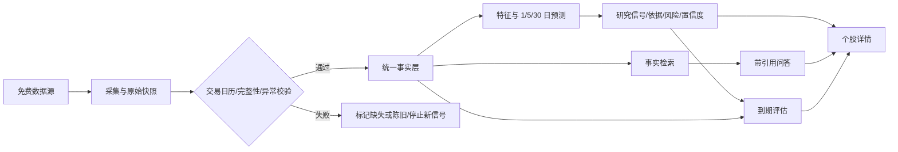

# 股票分析助手产品架构

| 属性 | 内容 |
|---|---|
| 状态 | 终版 |
| 决策日期 | 2026-11-18 |
| 目标版本 | 2026 年 11 月 MVP |
| 适用范围 | 本地个人使用、A 股、日级数据 |

## 1. 架构结论

采用 **“数据可信闭环优先 + 模块化单体”** 的产品架构。

MVP 主链路固定为：

> 查看 A 股日行情 → 个股问答 → 查看统一研究信号与 1/5/30 日预测 → 到期核验实际结果

组合分析仅保留未来领域边界，不进入本期实现与验收。当前核心矛盾是免费数据是否可信、预测能否验证，而不是并发与分布式扩展。因此 MVP 不引入微服务、消息队列、缓存集群或独立向量数据库。

## 2. 决策基线

### 2.1 业务目标与用户

- 目标用户：个人投资者。
- 核心价值：查询 A 股公司与行情事实，获得有依据、可回看、可验证的个股研究信号。
- 产品阶段：内部提效 → 免费工具 → 高价值分析订阅。后两阶段不属于本期商业化交付。
- 当前形态：本地个人使用，不对外提供公共服务。

### 2.2 MVP 范围

本期交付：

1. A 股证券主数据与日行情。
2. 基于本地事实的个股问答。
3. 面向所有用户一致的个股研究信号。
4. 未来 1/5/30 个交易日的涨跌幅预测、置信度、依据、风险因素、数据截止时间和模型版本。
5. 预测到期后的实际结果与评估。

本期不做：

- 组合推荐、组合收益、权重分配、调仓与通知。
- 自动交易、交易指令和券商连接。
- 个性化投资建议、真实持仓与用户画像。
- 社区、账户、支付与订阅权益。
- 实时或分钟级行情。
- 公开部署及商业化运营能力。

### 2.3 资源与技术约束

- 团队：1 名产品、1 名研发；研发需兼顾前端、后端、数据与本地运维。
- 已确认技术倾向：Go + Vue 3 + SQLite。
- 模型：默认豆包，通过适配边界支持替换供应商。
- 数据：MVP 只使用免费数据源，不以付费数据作为可用性兜底。
- 数据频率：日级更新。
- 历史目标：从 2000 年起，以证券实际上市日和免费源真实覆盖为准，不伪造缺失数据。

### 2.4 产品表述边界

- 界面统一使用“研究信号”“模型预测”，不表述为收益承诺。
- “置信度”在完成校准前称为“模型置信分”，不得解释为真实胜率。
- 不承诺确定价格点位，不把实验性结果标为高置信推荐。
- 没有合格数据证据时宁可停止生成新信号或拒答，也不编造结论。

## 3. 方案对比与选型

| 方案 | 优势 | 短板 | 适用场景 | 决策 |
|---|---|---|---|---|
| 页面演示优先：行情、问答、推荐各自直连数据与模型 | 页面最快可见，前期代码少 | 数据口径分裂、不可追溯、难以回测；数据源故障同时击穿功能 | 一次性演示 | 不采用 |
| 数据可信闭环优先：统一事实层 → 问答/预测 → 到期评估 | 可解释、可追溯、可重放、可验证；MVP 能力共用数据 | 首周必须先投入数据校验和评估闭环 | 当前 MVP 与后续产品底座 | **采用** |
| 平台/组合优先：账户、组合、策略、通知、实时任务一并建设 | 长期功能较完整 | 两人团队和月底周期不可行；提前引入运维、数据与合规成本 | 已有稳定授权和多人团队的公开产品 | 后续评估 |

## 4. 产品信息架构

### 4.1 首页与运行状态

展示最新有效交易日、数据更新时间、行情完整率和任务异常。数据陈旧或不完整时明确提示，不以旧数据伪装当天状态。

### 4.2 股票搜索与列表

按证券主数据查询 A 股，展示最新日行情、数据日期与质量状态。

### 4.3 个股详情

集中展示：

- 最新行情与历史走势。
- 统一研究信号。
- 1/5/30 日涨跌幅预测与模型置信分。
- 主要依据、风险因素、引用来源和数据截止时间。
- 已到期预测的实际表现与历史成绩。

### 4.4 个股问答

先检索本地事实，再生成回答。事实性回答必须带来源和数据截止时间；无可验证证据时明确拒答或说明未知。

### 4.5 系统状态与质量报告

提供数据覆盖、缺失、采集失败、补采、预测任务和模型调用状态，确保单人研发可以定位“哪天、哪只股票、哪一步失败”。

## 5. 领域划分与责任边界

| 领域 | 核心责任 | 明确不承担 |
|---|---|---|
| 证券主数据与交易日历 | 股票身份、上市/退市/停牌状态、代码变更、交易日和预测到期日 | 行情推断与预测结论 |
| 行情事实 | 原始快照、标准化日线、复权信息、来源、抓取时间、质量状态 | 研究信号 |
| 公司事实 | 可稳定获取且允许使用的公司结构化事实和文档引用 | 无来源的全网事实 |
| 分析与预测 | 特征、模型版本、1/5/30 日预测、置信分、依据、风险与统一研究信号 | 交易执行、收益保证 |
| 问答 | 事实检索、带引用生成、拒答和超时降级 | 绕过事实层直接取数 |
| 评估 | 到期实际收益、误差、方向准确率、置信度校准和基线对照 | 只展示命中案例 |
| 运行与审计 | 采集/校验/预测任务、重试、错误、模型调用量与成本 | 首期独立运维平台 |

组合域仅预留未来输入输出契约：股票集合、权重、组合收益、风险暴露和调仓建议。MVP 不建持仓数据、不提供组合页面、不引入账户体系。

## 6. 核心依赖

| 依赖 | 用途 | MVP 边界 |
|---|---|---|
| 免费行情/财务数据源 | 证券、日线和可用公司事实 | 上线前验证覆盖、稳定性、限流和授权；不使用付费兜底 |
| A 股交易日历与证券主数据 | 判断应有数据、交易窗口和预测到期日 | 作为完整率与预测周期的统一基准 |
| 豆包及备选模型供应商 | 基于事实生成问答或解释 | 通过适配接口隔离；不可绕过事实层直接构造事实 |

本期不依赖券商接口、支付、用户身份、消息推送、独立向量数据库、缓存集群或消息队列。数据源与模型供应商需要清晰的进程内适配边界，但不拆服务。

## 7. 核心数据流

### 7.1 强制降级规则

- 当日数据不完整或异常：展示最后有效日期和缺失原因，停止生成当日新信号。
- 模型不可用：行情仍可访问；问答返回结构化事实或可重试错误，不编造回答。
- 预测任务失败：保留旧预测，但必须明确标为“已过期”。
- 免费源失效：执行重试、补采或适配器切换；没有合格数据时停止更新，不用长期缓存掩盖故障。

## 8. 存储选型与数据契约

SQLite 满足本地单用户 MVP。逻辑上分开保存：

- 证券主数据与交易日历。
- 原始数据快照。
- 标准化日行情与复权信息。
- 公司事实与来源引用。
- 特征、预测结果和模型版本。
- 问答记录与引用。
- 预测到期后的实际结果与评估。
- 任务状态与错误日志。

数据契约：

1. 原始数据只追加，不以清洗结果覆盖；标准化数据可按版本重建。
2. 关键结果以 `stock + trade_date + source/version` 幂等写入，任务可安全重跑。
3. 每条预测固定记录输入截止时间、特征版本、模型版本和生成时间，保证可重放。
4. 问答引用指向本地事实记录，不只保存易失效的外部链接。
5. 复权、分红送转、停牌、涨跌停、退市和代码变更进入质量校验。
6. 历史回测必须说明退市股票覆盖，避免幸存者偏差。

## 9. MVP 验收门禁

| 维度 | 验收标准 |
|---|---|
| 数据新鲜度 | 交易日 18:00 前完成当日日线更新；未完成时同时展示陈旧/缺失状态 |
| 行情完整率 | 对证券状态判定“当日应有记录”的股票，有效覆盖率 ≥ 99.5%；停牌、未上市、已退市按主数据状态处理 |
| 问答可追溯性 | 100% 回答展示来源与数据截止时间；抽样中 ≥ 95% 可验证事实陈述可映射到引用记录 |
| 预测可追溯性 | 100% 预测展示三个周期、输入日期、模型版本、置信度、主要依据和风险 |
| 时延 | 本地事实查询 p95 ≤ 2 秒；含模型完整回答 p95 ≤ 10 秒；20 秒超时并允许重试 |
| 运行可用性 | 交易日采集、校验、预测主链路月成功率 ≥ 99%；失败可重跑且不产生重复结果 |
| 预测质量 | 完成无未来数据泄漏的滚动回测，分别报告 1/5/30 日 MAE、方向准确率、置信度分桶校准，并与朴素基线对照 |

预测质量不设置“必须赚钱”指标。未优于零涨跌、历史均值等朴素基线的结果可以作为实验展示，但不得标为高置信研究信号。

## 10. 交付顺序

### 10.1 MVP（截至 2026-11-30）

1. 用少量股票和多个历史年份验证免费源的字段、授权、限流、复权及 2000 年以来覆盖，形成数据源准入结论和逐年覆盖报告。
2. 打通证券主数据、日线采集、标准化、质量报告和补采。
3. 完成个股页面与基于事实层的问答，落实来源和截止时间展示。
4. 完成三个周期预测、统一研究信号、解释与风险展示。
5. 完成历史滚动回测、到期评估、失败降级和端到端验收。

如果自然周期不足，以历史滚动回测完成 MVP 验收，线上实际结果持续积累。

### 10.2 后续演进

1. **稳定期**：增加第二免费源交叉校验、预测成绩单和人工纠错入口。
2. **组合期**：单股数据与评估闭环稳定后，引入组合、权重、收益归因与调仓提醒；仍不连接真实交易。
3. **公开免费期**：先完成数据授权、免责声明、风险提示、内容审核、账户、限流、隐私与故障监控评审。
4. **订阅期**：增加权益和计费；基于实测容量决定是否迁移 PostgreSQL、引入异步任务系统或拆分服务。

## 11. 风险与止损条件

| 风险 | 影响 | 应对与止损条件 |
|---|---|---|
| 免费源不稳定、限流或授权不清 | 数据断供，无法公开使用 | 做准入验证、保留原始快照和适配层；授权不清时只限本地研究，禁止公开发布 |
| 2000 年历史或退市股票缺失 | 回测失真、产生幸存者偏差 | 输出逐年/逐证券覆盖报告；覆盖不足时禁止宣称“全历史验证” |
| 未来数据泄漏或复权错误 | 预测指标虚高 | 使用时间切分滚动回测、可重放特征和截止时间审计；审计未通过不得发布信号 |
| 模型幻觉 | 错误事实影响判断 | 仅基于本地事实生成并强制引用；无证据拒答 |
| 置信度误导 | 用户把分数理解为成功概率 | 完成分桶校准前只称“模型置信分” |
| 范围持续膨胀 | 三条主链路均无法完整交付 | 组合、通知、实时行情、账户和公开部署移出 MVP |
| 本地版本直接商业化 | 数据授权、金融内容与隐私风险 | 授权与合规评审通过前，不开放公众访问或收费 |

## 12. 反模式提醒

- 让大模型绕过统一事实层自行取数，或把模型回答直接当作事实库。
- 只展示研究信号，不保存当时输入、模型版本和后续实际结果。
- 使用随机切分验证时间序列，或把未来可见的财报、复权信息用于历史预测。
- 用前向填充掩盖缺失价格，或让陈旧预测看起来仍是当天结果。
- 把置信度包装成胜率或收益保证。
- 为未来可能出现的并发提前引入微服务、Kafka、Redis、向量库和复杂账户体系。

## 13. 架构裁决原则

本产品的首要原则不是“输出更多推荐”，而是确保每一条研究结果都能回答：

1. 使用了哪一天、哪个来源的数据？
2. 使用了哪个特征与模型版本？
3. 为什么得出该结论，风险是什么？
4. 到期后的真实结果如何，是否优于朴素基线？

不能满足以上问题的能力，不进入 MVP 的正式产品承诺。
