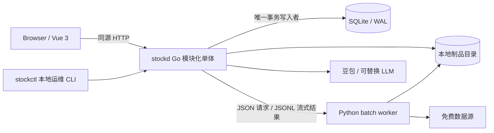
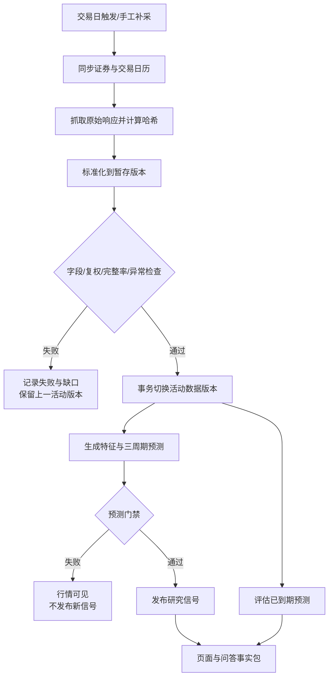

# 股票分析助手技术架构

| 属性 | 内容 |
|---|---|
| 状态 | 待评审 |
| 设计日期 | 2026-11-19 |
| 目标版本 | 2026 年 11 月 MVP |
| 设计基线 | `product-architecture.md` 终版 |
| 适用范围 | 本地单用户、A 股、日级数据 |

## 1. 结论

采用 **Go 模块化单体 + Vue 3 单页应用 + SQLite 主库 + 受控 Python 批处理 Worker**。

- Go 进程是唯一业务入口、任务编排者和 SQLite 写入者，负责 REST API、数据校验、状态发布、问答编排、任务恢复和本地运维接口。
- Vue 3 构建后作为静态资源嵌入 Go 二进制，由同一进程同源提供，不单独部署前端服务。
- Python Worker 不是常驻微服务，只承接免费数据 SDK 和数值模型生态中 Go 不擅长的批处理工作；由 Go 以有版本的 JSON/JSONL 协议调用，超时或失败不会影响行情只读能力。
- SQLite 保存事务性事实、版本、结果和审计元数据；大体积、不可变的原始响应、特征矩阵与模型文件保存到本地制品目录，并在 SQLite 中记录路径、哈希和来源。
- 所有用户查询只读取已经通过质量门禁的活动数据版本。采集中的半成品不得直接覆盖线上可见数据。

当前核心矛盾是免费数据的稳定性、口径和历史覆盖，以及预测是否可重放和可验证，不是并发。因此不引入微服务、消息队列、Redis、独立向量数据库、Kubernetes 或账户体系。

## 2. 决策基线与非目标

已确认约束：

- 单研发负责前端、后端、数据、模型接入和本地运维。
- MVP 仅本地个人使用；只支持 A 股日级数据，历史目标从 2000 年起。
- 功能为日行情、个股问答、统一研究信号、1/5/30 交易日预测和到期评估。
- 默认豆包，模型供应商可替换；只使用免费数据源。
- 交易日 18:00 数据、99.5% 行情完整率、带引用问答和无未来数据泄漏回测是验收门禁。

本期明确不建设：

- 组合、账户、权限、支付、订阅、通知和真实交易。
- 实时/分钟行情、在线训练和盘中预测。
- 多机部署、高可用集群、分布式任务和多租户隔离。
- 让大模型决定数值预测，或让模型绕过本地事实层自行取数。

## 3. 方案对比

| 方案 | 优势 | 短板 | 适用场景 | 决策 |
|---|---|---|---|---|
| 全 Go 单体，直接调用免费源 HTTP 接口并在 Go 内训练 | 单语言、分发简单 | 多数免费源无稳定官方 Go SDK；直接依赖非公开接口，字段变更与反爬维护成本高；数值分析生态弱 | 数据供应商提供正式 Go/HTTP 契约 | 不采用 |
| **Go 模块化单体 + 受控 Python Worker** | 保留 Go 的服务边界与可维护性；复用成熟免费数据和数值分析生态；Worker 可被替换 | 双工具链；需处理进程协议、超时和环境锁定 | **当前两人团队、本地数据与分析型 MVP** | **采用** |
| Python 一体化后端 + Vue | 数据和模型开发最快，技术组件少 | 偏离已确认 Go 技术方向；后续服务治理与类型契约需要重建 | 数据科学验证或一次性原型 | 仅用于独立实验，不作主架构 |
| 提前拆分采集、模型、问答微服务 | 故障域和扩容独立 | 部署、协议、追踪和运维成本显著超过当前业务收益 | 多团队、多机、独立扩缩容后 | 后续按指标触发 |

推荐方案不是“为了保留 Go 而强行混合语言”。它把变化最快、供应商绑定最强的采集与模型代码限制在批处理边界内，同时让数据库、一致性、接口和降级规则仍由一个 Go 进程统一控制。

## 4. 运行时架构与故障域



### 4.1 进程职责

| 进程/组件 | 职责 | 故障后的降级 |
|---|---|---|
| `stockd` | API、静态页面、领域服务、调度、质量门禁、SQLite 写入、问答编排 | 主进程不可用时服务整体不可用；重启后从任务状态恢复 |
| `stockctl` | 初始化、补采、日更、重算、回测、数据库检查与备份 | 不影响只读页面；命令可安全重跑 |
| Python Worker | 数据源适配、批量转换、特征/训练/推理/回测 | 停止新数据和新预测；已发布行情与历史结果保持可读 |
| LLM 适配器 | 基于事实包生成问答与解释 | 行情和数值预测仍可用；问答返回结构化事实或明确可重试错误 |
| SQLite/制品目录 | 事实、版本、任务状态与不可变制品 | 任一损坏都阻止发布新版本；通过成对备份恢复 |

Go 是 SQLite 的唯一写入者。Python 不直接连接数据库，避免双语言并发写、迁移漂移和锁竞争。Worker 标准输出只允许协议数据，日志写标准错误；Go 在校验完整批次后用事务写入。

### 4.2 Worker 协议

请求包含 `schema_version`、`run_id`、`operation`、`provider`、`as_of` 和参数；响应为 JSONL：开始清单、零到多条记录、结束摘要。每批必须提供记录数和内容哈希。

协议约束：

1. Go 为每次执行设置超时、最大输出和取消信号，非零退出码视为失败。
2. 未收到结束摘要、哈希不一致或字段校验失败时，整批拒绝发布。
3. Worker 版本、Python 依赖锁文件哈希和数据源适配器版本写入任务记录。
4. 协议保持与实现语言无关，后续可把某个 Worker 替换为 Go 或远端服务而不改领域层。

## 5. 模块与依赖方向

模块按业务能力切分，不建立全局 `controller/service/repository` 大目录。

| 模块 | 责任 | 只允许依赖 |
|---|---|---|
| `securities` | 证券身份、状态、代码变更、交易日历 | `platform` |
| `marketdata` | 快照登记、日线标准化、复权信息、完整性与活动版本 | `securities`、`platform` |
| `facts` | 公司事实、来源、可用时间与引用检索 | `securities`、`platform` |
| `analysis` | 特征清单、模型运行、三周期预测、研究信号 | `marketdata`、`facts`、`securities` |
| `evaluation` | 到期收益、误差、方向准确率、校准与基线 | `analysis`、`marketdata` |
| `qa` | 事实检索、提示模板、供应商调用、引用校验与拒答 | `facts`、`marketdata`、`analysis` |
| `jobs` | 日更编排、租约、重试、恢复和运行状态 | 各模块公开应用接口 |
| `platform` | 配置、SQLite、迁移、日志、时钟、HTTP 和制品存储 | 不依赖业务模块 |

领域模块不得直接调用数据源、LLM SDK 或 Python；这些依赖通过端口接口从 `platform/adapters` 注入。领域对象不得暴露 SQL 行、供应商响应或前端 DTO。

## 6. 数据源与模型选型

### 6.1 免费数据源

MVP 采用“一个活动主源 + 可替换适配器”，不自动拼接多个来源后生成看似完整的数据。

| 候选 | 优势 | 主要问题 | 结论 |
|---|---|---|---|
| BaoStock | 无需注册的 Python API；覆盖历史 A 股日线、复权和部分财务/证券信息；历史范围满足 2000 年目标的候选条件 | 免费服务无 SLA；日更时点、退市覆盖、字段语义和商业授权需实测 | **首个准入候选与默认适配器** |
| AKShare | 数据面广，可从多公开来源获取行情与公司数据，适合补充验证 | 聚合上游多、接口与字段会随上游变化；不同接口授权边界不同 | **备用适配器；不在 MVP 静默混源** |
| 直接调用东方财富/新浪等非公开接口 | 无 Python 运行时，开发初期直接 | 无稳定契约，反爬和字段变更风险由项目自行承担 | 不作为架构基线 |

BaoStock 的选择是有门槛的，不等于已经承诺可用。实施第一个 Spike 必须用跨年份、停牌、复权、退市样本验证：

- 交易日 18:00 前可获得当日数据，且应有股票有效覆盖率达到 99.5%。
- 价格、成交量、复权、停牌和证券状态字段可明确映射，随机样本可重放。
- 2000 年以来逐年覆盖和退市股票覆盖可以量化；缺口会进入报告。
- 限流、服务条款和本地非商业使用边界有记录。

任一硬门禁失败时，不修改统一事实模型，改为评估 AKShare 适配器；仍失败则收缩历史或新鲜度目标并回到产品架构评审，不能靠静默填数通过验收。

### 6.2 数值预测与大模型

数值预测和语言生成必须分离：

- Python 数值管线生成 1/5/30 交易日预测。MVP 先实现零涨跌、历史均值/动量等朴素基线，再使用正则化线性模型作为第一个可解释候选；只有滚动回测优于基线后才允许进入正式研究信号。
- 训练、验证和预测按时间顺序切分，所有输入使用 `available_at <= as_of`，禁止随机切分和未来修订数据泄漏。
- 模型置信分来自样本外误差、稳定性和分桶校准；校准前不得表达为成功概率。
- 豆包只对检索出的事实包和数值结果进行问答或自然语言解释，不负责生成价格预测。默认使用火山方舟官方 Go SDK/V3 兼容接口，并封装为最小 `LLMProvider` 接口。
- 提示模板、模型/端点、采样参数、输入事实哈希和输出引用都需要版本化；API Key 只从环境变量或本机密钥设施读取。

不引入 LangChain 或 Agent 框架。当前问答流程固定为“检索 → 组装事实包 → 单次生成 → 引用校验 → 返回/拒答”，普通代码更容易测试和审计。

## 7. 核心数据流与发布事务



发布采用两阶段语义：

1. **构建阶段**：原始制品和标准化记录写入新的 `dataset_version`，状态为 `building`。
2. **验证阶段**：生成质量报告；失败版本标记为 `rejected`，用户仍读取上一 `active` 版本。
3. **发布阶段**：在单个 SQLite 事务内把新版本切为 `active` 并撤销旧活动标记。
4. **派生阶段**：特征、预测和评估引用确定的活动版本；派生失败不能回滚已合格行情，但不得发布不完整信号。

每个任务以 `job_type + effective_date + scope + input_version` 建立唯一键。重试更新同一逻辑任务的 attempt，不创建重复业务结果。

## 8. 存储设计

### 8.1 选型

SQLite 使用 WAL、`foreign_keys=ON`、`busy_timeout` 和受控连接池。它适合本地单用户、单写入者和数千万级窄日线记录；选它是降低运维成本，不代表可以忽略索引、备份和迁移。

大体积不可变内容不放入数据库 BLOB：

- `var/raw/`：按来源和日期保存压缩原始响应。
- `var/artifacts/`：特征矩阵、回测输出和模型文件。
- SQLite `artifacts` 表：保存相对路径、类型、字节数、SHA-256、创建任务和 schema 版本。

数据库和制品目录是一个备份单元。任何一方缺失都视为备份不完整。

### 8.2 逻辑表组

| 表组 | 关键表/内容 | 核心约束 |
|---|---|---|
| 主数据 | `instruments`、`instrument_aliases`、`trading_days` | 股票身份使用内部 ID；代码可变但身份不变 |
| 来源与版本 | `source_snapshots`、`dataset_versions`、`artifacts` | 原始制品只追加；活动版本唯一；哈希可校验 |
| 行情事实 | `daily_bars`、`corporate_actions`、`data_quality_issues` | 主键包含证券、交易日、复权口径和数据版本；不按股票建表 |
| 公司事实 | `facts`、`fact_sources`、`fact_citations` | 同时记录 `effective_at` 与 `available_at`，回测按后者截断 |
| 模型与预测 | `model_versions`、`feature_runs`、`predictions`、`signals` | 保存输入版本、as-of、目标交易日、模型/特征/代码版本 |
| 评估 | `prediction_outcomes`、`evaluation_runs`、`calibration_bins` | 预测与实际一一关联，禁止覆盖历史结果 |
| 问答 | `qa_sessions`、`qa_messages`、`qa_citations` | 回答引用本地事实 ID；保存模型和提示版本 |
| 运行审计 | `job_runs`、`job_attempts`、`provider_calls`、`quality_reports` | 每次失败可定位、可重试、可统计成本和耗时 |

价格建议按固定精度整数存储，收益和模型指标使用浮点并明确单位；交易日使用 ISO 日期，所有时间戳使用 UTC，界面按本地时区展示。迁移只能前向执行，发布前用真实副本演练并自动备份。

SQLite FTS5 足够支持 MVP 的关键词事实检索。当前不建设向量数据库；只有在事实量和真实问答评测证明关键词召回不足后，再考虑把 embedding 作为可重建制品加入。

## 9. API 与接口契约

前后端使用版本化 REST JSON，API 前缀为 `/api/v1`，统一返回 `request_id`、明确错误码和数据截止时间。

| 接口 | 用途 |
|---|---|
| `GET /system/status` | 最新活动数据版本、交易日、完整率和任务异常 |
| `GET /stocks?query=` | 按代码/名称搜索证券主数据 |
| `GET /stocks/{id}` | 个股基础信息与最新数据状态 |
| `GET /stocks/{id}/bars` | 按日期范围和复权口径查询日线 |
| `GET /stocks/{id}/signal` | 当前研究信号、三周期预测、依据和风险 |
| `GET /stocks/{id}/predictions` | 历史预测、状态与到期结果 |
| `POST /stocks/{id}/questions` | 基于事实层问答，返回回答、引用、截止时间和模型版本 |
| `GET /quality/latest` | 当前数据覆盖与质量缺口 |

写入型运维能力不通过公开 HTTP 暴露，由 `stockctl` 提供 `sync`、`backfill`、`predict`、`evaluate`、`doctor`、`backup` 命令。这样无需为本地 MVP 提前建设管理端鉴权。

问答请求 20 秒硬超时；客户端断开必须取消下游模型调用。MVP 返回完整回答，不为视觉效果优先引入流式协议；真实体验证明需要后再增加 SSE。

## 10. 项目结构

```text
stock_analysis_assistant/
├── cmd/
│   ├── stockd/                 # HTTP、静态页面和内置调度入口
│   └── stockctl/               # 初始化、补采、回测、检查和备份
├── internal/
│   ├── securities/
│   ├── marketdata/
│   ├── facts/
│   ├── analysis/
│   ├── evaluation/
│   ├── qa/
│   ├── jobs/
│   └── platform/
│       ├── adapters/           # 数据 Worker、LLM、文件制品等实现
│       ├── config/
│       ├── database/
│       ├── httpserver/
│       └── observability/
├── migrations/                 # 有序 SQL 迁移
├── api/openapi.yaml            # REST 契约与错误码
├── web/                        # Vue 3 + TypeScript + Vite
│   └── src/
│       ├── features/           # status、stocks、signal、qa、quality
│       ├── shared/
│       └── api/
├── worker/                     # Python 批处理包
│   ├── stock_worker/
│   │   ├── providers/
│   │   ├── features/
│   │   ├── models/
│   │   └── protocol/
│   ├── tests/
│   └── pyproject.toml
├── configs/config.example.yaml
├── testdata/                   # 脱敏且固定的数据源契约样本
├── docs/architecture/
├── var/                        # 本地数据库、原始数据、制品和备份；不入库
├── Makefile
└── README.md
```

每个 Go 领域模块内部可有 `domain`、`app`、`ports`、`adapters`，但只在确有多种实现时创建；禁止先生成大量空层。前端按用户能力切分，不复制后端技术分层。

## 11. 配置、可观测与运维

- 默认只监听 `127.0.0.1`，前后端同源；不配置公网 CORS 通配符。
- 普通配置来自 YAML，环境变量覆盖；API Key 不进入 YAML、日志、数据库或 Git。
- 使用 Go `slog` 输出结构化日志，贯穿 `request_id`、`run_id`、`dataset_version`、`instrument_id`。
- 任务状态、耗时、记录数、重试、完整率、模型 token/费用写入运行审计表；系统状态页直接读取这些结果。
- 日更采用内置调度加启动补偿：进程启动时检查最近交易日是否缺任务；同时保留 `stockctl sync --date` 手工恢复入口。
- 每次迁移和大规模补采前执行 SQLite 在线备份；恢复演练要同时校验 DB 和制品哈希。
- 保留最近活动版本及可配置数量的历史版本；清理必须先验证没有预测、问答或评估引用。

## 12. 测试与质量门禁

| 层级 | 必测内容 |
|---|---|
| 数据源契约测试 | 使用固定原始样本验证字段映射、单位、日期、复权、停牌和错误响应；CI 不依赖在线免费源 |
| 领域单测 | 交易日窗口、完整率分母、活动版本切换、幂等、拒答和预测到期计算 |
| SQLite 集成测试 | 从空库执行全部迁移、事务回滚、唯一键、级联边界和备份恢复 |
| 时间泄漏测试 | 任意训练/预测输入的 `available_at` 不得晚于 `as_of`；滚动窗口不可看到未来 |
| Worker 协议测试 | 截断输出、错误哈希、超时、取消、版本不兼容和超大批次 |
| 端到端测试 | 固定小样本完成采集 → 校验 → 发布 → 预测 → 问答 → 到期评估 |
| 前端测试 | 数据陈旧、无信号、模型失败、引用展示和主流程回归 |

在线数据源仅做手工或计划性 Smoke Test，结果不得决定普通 PR CI 是否通过。合并门禁至少包括 Go 测试与静态检查、Python 测试与格式检查、前端类型检查/测试/构建、迁移测试和 `git diff --check`。

## 13. 交付步骤

1. **骨架与契约**：建立目录、配置、迁移、OpenAPI、Worker 协议和最小状态页；不先堆页面。
2. **数据源 Spike**：实现 BaoStock 适配器，形成跨年份/状态样本、逐年覆盖与 18:00 新鲜度报告；依据门禁决定采用或切换 AKShare。
3. **可信行情链路**：完成主数据、原始制品、标准化、质量报告、两阶段发布、补采和系统状态。
4. **数值闭环**：实现朴素基线、正则化线性候选、滚动回测、三周期预测、置信分和到期评估。
5. **个股体验**：交付搜索、行情、研究信号、依据、风险和历史成绩。
6. **带引用问答**：接入豆包适配器、事实包、引用校验、超时与拒答降级。
7. **验收与可恢复性**：完成端到端门禁、备份恢复、失败重跑和本地运行手册。

如果时间受限，裁剪顺序是：先保留可信行情和质量报告，再保留可验证的基线预测，最后接入问答；不能用未验证数据和模型生成“看起来完整”的推荐页面。

## 14. 风险与演进触发条件

| 风险 | 当下措施 | 触发后的演进 |
|---|---|---|
| 免费源不可用或字段漂移 | 适配器、原始快照、契约样本、发布门禁 | 切换备用适配器；目标仍不满足则回到产品范围评审 |
| 双语言增加交付复杂度 | Worker 非常驻、协议窄、依赖锁定、Go 唯一写库 | 数据/模型有正式 Go 实现后逐个替换，不整体重写 |
| SQLite 文件增大或锁竞争 | 原始/特征制品外置、复合索引、单写者、WAL | 出现多用户远程写或持续锁等待后再迁移 PostgreSQL |
| 日更任务超过窗口 | 可恢复分段任务、按股票/日期批次、只发布完整版本 | 单机优化后仍不能在门禁前完成，再引入并行 Worker/任务队列 |
| 问答幻觉或引用错配 | 事实包、引用 ID、生成后校验、无证据拒答 | 先改检索与评测，不以更大模型掩盖数据问题 |
| 预测虚高 | `available_at` 截断、滚动回测、朴素基线、版本审计 | 未优于基线时维持实验标识，不升级为正式信号 |
| 本地版转公开产品 | 仅绑定本机、不建设虚假安全感 | 公开前单独完成授权、合规、身份、限流、隐私和 SRE 架构评审 |

服务拆分看故障域、部署节奏和团队所有权，不看代码行数；数据库迁移看远程并发写和运维目标，不只看文件大小；消息队列看跨进程持久任务需求，不因“以后可能扩展”提前引入。

## 15. 反模式提醒

- Python 和 Go 同时写 SQLite，或让 Worker 自己执行数据库迁移。
- 采集后直接覆盖当前行情，没有暂存版本、质量门禁和原子发布。
- 多个免费源逐字段拼接却不记录来源、优先级和冲突。
- 用大模型直接预测涨跌幅，或让模型生成无法映射到本地事实的引用。
- 只保存最终推荐，不保存输入版本、代码/特征/模型版本和 `as_of`。
- 按股票动态建表、把大块原始响应塞进 SQLite BLOB，或无索引地扫描全历史日线。
- 为本地单用户提前引入微服务、Kafka、Redis、向量库、Kubernetes 和复杂鉴权。
- 因双语言存在就把内部 Worker 包装成网络微服务，徒增部署和安全面。
- 免费数据源未通过授权与覆盖验证，就把本地 MVP 直接开放公网或收费。

## 16. 待评审裁决

本设计请求确认三项技术决策：

1. 接受 Go 主进程 + 非常驻 Python Worker 的双语言边界，以换取免费数据和数值分析生态；Go 保持唯一数据库写入者。
2. 接受 BaoStock 作为首个有条件的准入候选、AKShare 作为备用适配器；最终启用以数据源 Spike 门禁为准，不承诺静默混源。
3. 接受 SQLite + 本地不可变制品目录作为一个备份单元；不把原始响应、特征矩阵和模型大文件强塞进 SQLite。

上述三项确认后，技术架构可转终版，并据此进入项目骨架和数据源 Spike 实施。
