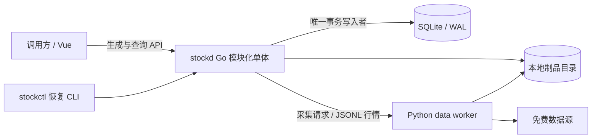
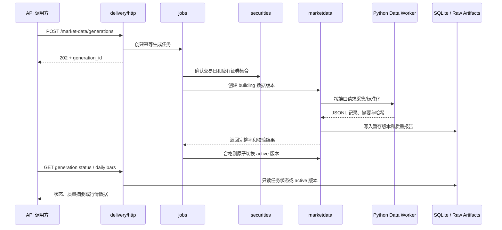
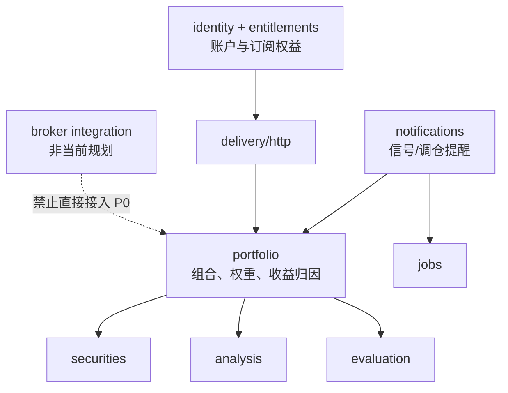
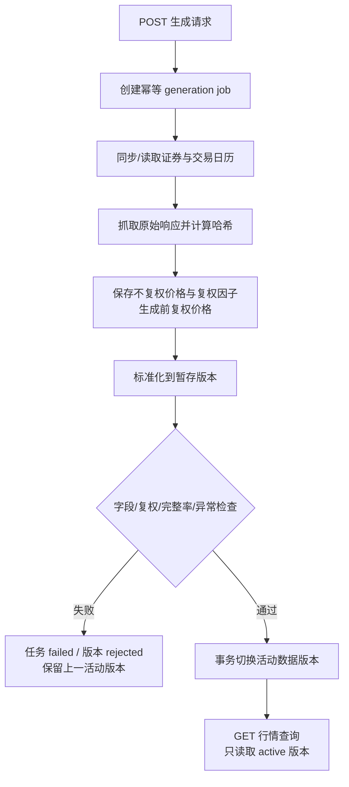
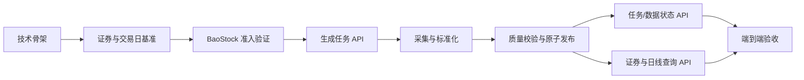

# 股票分析助手技术架构

| 属性 | 内容 |
|---|---|
| 状态 | 终版 |
| 设计日期 | 2026-11-19 |
| 行情模型修订 | 2026-11-24，详见 `market-data-model.md` |
| 目录能力修订 | 2026-11-25，按当前实现合并模块职责、依赖与本地存储约定 |
| 目标版本 | 技术一期：行情数据最简 MVP |
| 设计基线 | `product-architecture.md` 终版 |
| 适用范围 | 本地单用户、A 股、日级数据 |

## 1. 结论

采用 **Go 模块化单体 + Vue 3 单页应用 + SQLite 主库 + 受控 Python 批处理 Worker**。

- Go 进程是唯一业务入口、任务编排者和 SQLite 写入者。一期只负责行情生成 API、行情查询 API、数据校验/发布与任务恢复。
- 后续 Vue 3 页面构建后可作为静态资源嵌入 Go 二进制；一期 API 验收不依赖前端页面。
- Python Worker 不是常驻微服务；一期只承接免费数据 Python SDK 的采集/转换，由 Go 以有版本的 JSON/JSONL 协议调用，超时或失败不会影响已发布行情查询。
- SQLite 保存证券、标准化行情、数据版本和任务审计；大体积、不可变的原始响应保存到本地制品目录，并在 SQLite 中记录路径、哈希和来源。
- 所有用户查询只读取已经通过质量门禁的活动数据版本。采集中的半成品不得直接覆盖线上可见数据。

**技术一期只有一个交付闭环：通过 API 触发行情生成（采集 → 标准化 → 校验 → 发布），再通过 API 查询已发布行情。** 预测、评估、问答和组合均为后续阶段，不进入一期 API 或验收。

当前核心矛盾是免费数据的稳定性、口径和历史覆盖，不是并发。因此不引入微服务、消息队列、Redis、独立向量数据库、Kubernetes 或账户体系。

## 2. 决策基线与非目标

已确认约束：

- 单研发负责前端、后端、数据、模型接入和本地运维。
- 技术一期仅本地个人使用；只支持 A 股日级数据，历史目标从 2000 年起。
- 技术一期功能仅为行情数据生成和行情数据查询；生成指“从免费源采集、标准化、校验并发布可查询版本”，不指随机模拟行情。
- 一期只使用免费数据源，不接入豆包，不建设预测模型。
- 一期验收门禁为：交易日 18:00 数据、99.5% 行情完整率、生成任务幂等可恢复、查询只读取活动版本。
- 用户查询历史日线默认使用前复权 `qfq`；不复权 `none` 仅在调用方显式指定时返回。复权只作用于价格字段，成交额 `amount` 始终保留当日真实成交金额。
- 前复权不是独立任务，而是行情生成任务的标准化步骤；系统保存不复权价格与复权因子/公司行动，由本地生成可审计的前复权序列。
- 日行情完整采集 BaoStock 18 个字段，包含四项估值、前收参考价、换手率、涨跌幅、交易/ST 状态；独立保存逐日状态、三个因子和完整分红记录。详细口径以 [一期日行情数据模型](market-data-model.md) 为准。

终版产品架构中的个股问答、统一研究信号、1/5/30 交易日预测和到期评估仍保留，但按后续技术阶段建设，不作为一期完成条件。

本期明确不建设：

- 公司事实、预测、评估、问答、LLM 接入。
- 组合、账户、权限、支付、订阅、通知和真实交易。
- 实时/分钟行情、在线训练和盘中预测。
- 多机部署、高可用集群、分布式任务和多租户隔离。

## 3. 方案对比

| 方案 | 优势 | 短板 | 适用场景 | 决策 |
|---|---|---|---|---|
| 全 Go 单体，直接调用免费源 HTTP 接口 | 单语言、分发简单 | 多数免费源无稳定官方 Go SDK；直接依赖非公开接口，字段变更与反爬维护成本高 | 数据供应商提供正式 Go/HTTP 契约 | 不采用 |
| **Go 模块化单体 + 受控 Python Worker** | 保留 Go 的服务边界与可维护性；复用成熟免费数据 SDK；Worker 可被替换 | 双工具链；需处理进程协议、超时和环境锁定 | **当前两人团队、本地行情数据 MVP** | **采用** |
| Python 一体化后端 + Vue | 数据和模型开发最快，技术组件少 | 偏离已确认 Go 技术方向；后续服务治理与类型契约需要重建 | 数据科学验证或一次性原型 | 仅用于独立实验，不作主架构 |
| 提前拆分采集、模型、问答微服务 | 故障域和扩容独立 | 部署、协议、追踪和运维成本显著超过当前业务收益 | 多团队、多机、独立扩缩容后 | 后续按指标触发 |

推荐方案不是“为了保留 Go 而强行混合语言”。它把变化最快、供应商绑定最强的采集与模型代码限制在批处理边界内，同时让数据库、一致性、接口和降级规则仍由一个 Go 进程统一控制。

## 4. 运行时架构与故障域



### 4.1 进程职责

| 进程/组件 | 职责 | 故障后的降级 |
|---|---|---|
| `stockd` | 行情生成/查询 API、任务编排、质量门禁、活动版本发布、SQLite 写入 | 主进程不可用时 API 整体不可用；重启后从任务状态恢复 |
| `stockctl` | 初始化、手工补采、数据库检查与备份；作为 API 失败时的恢复入口 | 不影响查询；命令可安全重跑 |
| Python Data Worker | BaoStock 等数据源适配和批量字段转换 | 停止新数据生成；已发布行情保持可读 |
| SQLite/制品目录 | 证券、行情、版本、任务状态与原始制品 | 任一损坏都阻止发布新版本；通过成对备份恢复 |

Go 是 SQLite 的唯一写入者。Python 不直接连接数据库，避免双语言并发写、迁移漂移和锁竞争。Worker 标准输出只允许协议数据，日志写标准错误；Go 在校验完整批次后用事务写入。

### 4.2 Worker 协议

请求包含 `schema_version`、`run_id`、`operation`、`provider`、`as_of` 和参数；响应为 JSONL：开始清单、零到多条记录、结束摘要。每批必须提供记录数和内容哈希。

协议约束：

1. Go 为每次执行设置超时、最大输出和取消信号，非零退出码视为失败。
2. 未收到结束摘要、哈希不一致或字段校验失败时，整批拒绝发布。
3. Worker 版本、Python 依赖锁文件哈希和数据源适配器版本写入任务记录。
4. 协议保持与实现语言无关，后续可把某个 Worker 替换为 Go 或远端服务而不改领域层。

## 5. 模块关系与责任

模块按业务能力切分，不建立全局 `controller/service/repository` 大目录。一期只展示实际运行协作。

边界规则用文字固定：`platform` 提供无业务语义的技术原语；`securities` 提供证券和交易日基准；`marketdata` 负责行情版本；`jobs` 编排行情生成；`delivery` 暴露 API；`integrations` 实现数据源和存储端口。任何模块不得跨过公开接口直接读取其他模块的表。

### 5.1 一期运行协作图

一期只包含行情生成和查询：



行情生成是异步任务，HTTP 不等待全量采集完成。查询不触发采集，只读取活动版本。免费源或 Worker 故障时，用户仍能查询上一份已验证数据。

### 5.2 模块责任与阶段深度

#### `platform`：可恢复运行的技术底座

- **为什么存在**：让各领域共享一致的事务、时间、配置、日志和制品语义，避免每个模块各自处理 SQLite、路径与重试细节。
- **输入/依赖**：本地配置、环境变量、文件系统、SQLite 驱动；不依赖任何业务模块。
- **对上输出**：事务边界、迁移器、UTC 时钟、ID/哈希、结构化日志、制品读写、健康状态等窄接口。
- **一期建设**：配置加载、SQLite WAL/迁移/备份、不可变原始制品仓库、结构化日志、请求/任务关联 ID、统一错误类型。
- **后续建设**：PostgreSQL、对象存储、Prometheus、集中日志均是实现替换，不改变领域接口。
- **明确不做**：证券完整率、预测发布、引用校验等业务判断。

#### `securities`：回答“哪些证券在什么日期应当存在”

- **为什么存在**：行情完整率、1/5/30 个交易日目标日、上市/退市/停牌处理都依赖统一证券身份和交易日历；缺少它会把停牌误判为缺数，把自然日误当交易日。
- **输入**：证券清单、状态/代码变更、上市退市日期、交易日历的标准化记录。
- **输出**：内部 `instrument_id`、代码别名解析、指定日期的在市/应有证券集合、下 N 个交易日计算。
- **一期建设**：A 股证券主数据、代码/名称搜索、上市退市状态、交易日历、代码别名；提供只读查询接口。
- **后续建设**：板块/行业分类历史、复杂代码迁移、跨市场日历。
- **故障影响**：阻止新数据版本和预测发布；已发布数据仍可按内部 ID 读取。

#### `marketdata`：把不可靠外部行情变成可发布事实

- **为什么存在**：隔离免费源字段漂移，统一价格/成交量/复权口径，并保证页面只读取通过门禁的完整数据版本。
- **输入**：`securities` 的应有集合与交易日、数据源端口返回的原始记录/制品。
- **输出**：活动 `dataset_version`、标准化日线、复权/公司行动、逐日覆盖率、质量缺口和数据截止时间。
- **一期建设**：单活动主源、原始快照登记、不复权基准、复权因子/公司行动、本地前复权生成、幂等补采、暂存/校验/原子发布、99.5% 完整率报告、上一活动版本降级。
- **后续建设**：第二数据源交叉校验、来源冲突工作台、分钟行情、并行分片采集。
- **故障影响**：停止新预测/信号；页面继续读取上一活动版本并显示陈旧状态。

#### `facts`：保存“当时真正可知”的公司事实与证据

- **为什么存在**：问答和多角度分析不能只依赖价格，也不能把 LLM 回答当事实；必须记录事实内容、来源、生效时间和首次可用时间。
- **输入**：公司基础资料、报告期指标、允许使用的文档/结构化来源，以及来源元数据。
- **输出**：按 `instrument_id + as_of` 检索的事实包、引用 ID、`effective_at`、`available_at` 和来源。
- **阶段**：一期不建设；二期按分析实际需要引入公司基础资料和核心财务指标，三期再建设检索与引用。
- **后续建设**：完整财报、公告/新闻、语义检索、人工纠错和事实修订工作流。
- **故障影响**：行情仍可用；缺少证据的分析特征被排除，问答必须拒答或标明未知。

公司事实必须使用独立任务，不挂在行情发布事务内。预期流程为“全量补采/增量触发 → 保存原始来源 → 标准化事实 → 写入 `effective_at` 与 `available_at` → 质量校验 → 发布事实版本”。首次全量补采可以手工触发；增量频率必须在数据源、报告发布时间和授权边界确认后再配置，当前不预设日更或周更。

新闻采集不属于一期，也不与公司结构化事实共用未经区分的记录。进入建设前必须先确认合法来源、授权范围和分钟/小时/日级时效目标；确认后才实现“白名单来源拉取 → 保存原文及来源元数据 → URL/内容哈希去重 → 关联证券 → 记录 `published_at` 与 `available_at` → 质量与合规校验 → 发布供检索引用”的独立链路。

#### `analysis`：生成可重放的数值预测与研究信号

- **为什么存在**：把确定版本的事实转换为 1/5/30 日预测；保存输入、特征、模型和代码版本，使每次输出都可重放。
- **输入**：指定 `as_of` 的活动行情版本、事实版本、特征/模型定义和交易日目标日；价格特征默认使用截至 `as_of` 当时可知的前复权序列。
- **输出**：朴素基线、候选模型预测、模型置信分、风险因子、信号状态和全部版本引用。
- **阶段**：一期不建设；二期建设朴素基线、首个可解释候选、三周期预测、特征/模型版本和发布门禁。
- **后续建设**：更多基本面特征、树模型/集成模型、自动训练、模型注册与灰度比较。
- **故障影响**：不发布当天新信号；行情和历史预测仍可读，旧信号标记过期。

#### `evaluation`：回答“预测后来是否成立”

- **为什么存在**：没有到期核验，研究信号无法判断质量，置信分也无法校准；该模块防止只展示命中案例。
- **输入**：不可变预测、目标交易日、活动行情版本和朴素基线结果。
- **输出**：实际收益、MAE、方向准确率、分桶校准、相对基线表现和评估样本量。
- **阶段**：一期不建设；二期与预测同时建设历史滚动回测、到期核验和基线对照。
- **后续建设**：行业/市场状态切片、漂移监控、自动模型降级和公开成绩单。
- **故障影响**：不删除预测，但模型不得从“实验”晋级为正式研究信号。

#### `qa`：把本地证据组织成可引用回答

- **为什么存在**：控制检索、提示、模型调用、引用验证和拒答，防止大模型绕过事实层自由发挥。
- **输入**：用户问题，以及 `facts`、`marketdata`、`analysis` 提供的只读事实包。
- **输出**：回答、引用 ID、数据截止时间、模型/提示版本、拒答或可重试错误。
- **阶段**：一期不建设；三期建设单轮问答、豆包适配、引用校验、超时和拒答。
- **后续建设**：多轮会话、embedding 召回、问题分类、多个模型路由、评测集和人工反馈。
- **故障影响**：问答降级；行情、信号和评估不受影响。

#### `jobs`：把跨模块能力编排成可恢复业务流程

- **为什么存在**：日更不是单个函数，而是证券同步、采集、校验、发布、预测、评估的有序流程；它需要幂等、重试和断点恢复。
- **输入**：交易日触发、手工命令、各模块应用接口和上一次运行状态。
- **输出**：任务/attempt 状态、步骤结果、重试信息、系统状态摘要。
- **一期建设**：只做行情生成 DAG、唯一任务键、步骤级重试、启动补偿、手工补采、失败不越过质量门禁。
- **后续建设**：并行 Worker、持久消息队列、分布式租约和远程调度。
- **故障影响**：停止自动更新，但 `stockctl` 可诊断和手工恢复；读取链路不受影响。

#### `delivery` 与 `web`：把领域能力暴露为稳定用户体验

- **为什么存在**：API/UI 负责协议、参数、展示和错误映射，不应承载完整率、预测资格或引用真实性等业务规则。
- **输入**：各模块公开查询/命令接口与 OpenAPI 契约。
- **输出**：同源 REST JSON、首页状态、股票搜索、行情、预测/评估、问答页面。
- **一期建设**：行情生成 API、任务状态 API、证券搜索、日线查询和数据状态；生成能力不再只放在 `stockctl`，CLI 作为恢复工具保留。
- **后续建设**：SSE、账户、权限、移动端和公共 API。

#### `integrations`：供应商与技术实现的隔离带

- **为什么存在**：BaoStock、AKShare、豆包、Python 协议和 SQLite 都是可替换实现，不应污染领域模型。
- **一期建设**：BaoStock 候选适配器、Python Data Worker 客户端、SQLite repositories 和本地 raw artifact store；不接入豆包。
- **后续建设**：AKShare、其他 LLM、PostgreSQL、对象存储等适配器。
- **依赖方向**：适配器依赖领域端口和 `platform` 原语；领域模块不依赖适配器。具体实现只在 `cmd/*` 被选择和注入。

### 5.3 后续领域如何接入

后续能力只向内复用当前单股闭环，不能让 P0 模块提前依赖尚不存在的未来领域：



- **组合期**：新增独立 `portfolio` 模块，消费证券、单股信号和评估结果；当前模块不认识持仓、权重或用户。
- **提醒期**：`notifications` 消费已发布信号/组合事件，由 `jobs` 调度；它不直接监听数据库表。
- **公开/订阅期**：身份和权益在 delivery 边界鉴权，再把用户上下文传入未来模块；不把用户字段提前塞入行情和预测表。
- **交易连接**：仍属于明确非目标。即使未来评估，也必须经独立合规与安全架构，不复用“研究信号”接口直接下单。

## 6. 数据源与模型选型

### 6.1 免费数据源

一期采用“一个活动主源 + 可替换适配器”，不自动拼接多个来源后生成看似完整的数据。

| 候选 | 优势 | 主要问题 | 结论 |
|---|---|---|---|
| BaoStock | 无需注册的 Python API；覆盖历史 A 股日线、复权和部分财务/证券信息；历史范围满足 2000 年目标的候选条件 | 免费服务无 SLA；日更时点、退市覆盖、字段语义和商业授权需实测 | **首个准入候选与默认适配器** |
| AKShare | 数据面广，可从多公开来源获取行情与公司数据，适合补充验证 | 聚合上游多、接口与字段会随上游变化；不同接口授权边界不同 | **备用适配器；不在一期静默混源** |
| 直接调用东方财富/新浪等非公开接口 | 无 Python 运行时，开发初期直接 | 无稳定契约，反爬和字段变更风险由项目自行承担 | 不作为架构基线 |

BaoStock 的选择是有门槛的，不等于已经承诺可用。实施第一个 Spike 必须用跨年份、停牌、复权、退市样本验证：

- 交易日 18:00 前可获得当日数据，且应有股票有效覆盖率达到 99.5%。
- 不复权价格、成交量、复权因子/公司行动、停牌和证券状态字段可明确映射，随机样本可重放。
- 2000 年以来逐年覆盖和退市股票覆盖可以量化；缺口会进入报告。
- 限流、服务条款和本地非商业使用边界有记录。

复权计算责任不交给供应商黑盒：系统把不复权 OHLC、复权因子/公司行动和来源元数据保存为可审计基准，在 `marketdata` 内生成 `qfq` 序列。供应商返回的前复权值只用于契约测试和抽样核对；两者不一致时拒绝发布并记录质量问题，不能静默采用其中一方。若候选源只能返回预先复权后的结果，无法提供可验证的因子或公司行动，则它不满足该项准入门禁；应切换适配器或回到范围评审，不能假装完成本地可审计计算。

任一硬门禁失败时，不修改统一事实模型，改为评估 AKShare 适配器；仍失败则收缩历史或新鲜度目标并回到产品架构评审，不能靠静默填数通过验收。

### 6.2 后续阶段：数值预测与大模型

本节不属于一期实现，仅冻结后续边界。数值预测和语言生成必须分离：

- Python 数值管线生成 1/5/30 交易日预测。默认目标是基于 point-in-time 前复权收盘价计算的未来收益率，不承诺绝对价格点位；成交额使用真实 `amount`，不做复权。二期先实现零涨跌、历史均值/动量等朴素基线，再使用正则化线性模型作为第一个可解释候选；只有滚动回测优于基线后才允许进入正式研究信号。
- 训练、验证和预测按时间顺序切分，所有输入使用 `available_at <= as_of`；历史回测按当时可知的公司行动重建 point-in-time 前复权序列，不直接使用今天回看得到的复权结果，禁止随机切分和未来修订数据泄漏。
- 模型置信分来自样本外误差、稳定性和分桶校准；校准前不得表达为成功概率。
- 豆包只对检索出的事实包和数值结果进行问答或自然语言解释，不负责生成价格预测。默认使用火山方舟官方 Go SDK/V3 兼容接口，并封装为最小 `LLMProvider` 接口。
- 提示模板、模型/端点、采样参数、输入事实哈希和输出引用都需要版本化；API Key 只从环境变量或本机密钥设施读取。

不引入 LangChain 或 Agent 框架。当前问答流程固定为“检索 → 组装事实包 → 单次生成 → 引用校验 → 返回/拒答”，普通代码更容易测试和审计。

## 7. 核心数据流与发布事务



发布采用两阶段语义：

1. **构建阶段**：原始制品和标准化记录写入新的 `dataset_version`，状态为 `building`。
2. **验证阶段**：生成质量报告；失败版本标记为 `rejected`，用户仍读取上一 `active` 版本。
3. **发布阶段**：在单个 SQLite 事务内把新版本切为 `active` 并撤销旧活动标记。
4. **查询阶段**：查询接口只读取 `active` 版本，并返回版本号、数据截止时间和复权口径。

每个生成任务以 `mode + date/range + symbols + adjustment + provider` 的规范化哈希建立唯一键。相同请求复用既有任务；重试增加 attempt，不创建重复业务结果。

### 7.1 前复权触发与重算规则

前复权没有独立调度器，由以下入口创建同一种行情生成任务：

1. 调用 `POST /api/v1/market-data/generations`，省略 `adjustment` 时按 `qfq` 处理。
2. 手工提交 `daily + trade_date + qfq` 请求，日期必须已收盘；2026-11-24 批准的采集计划不含自动日更调度。
3. `stockctl generate/backfill -retry` 使用同一命令接口，用于失败恢复、抽样和历史补采。重启不会自动重试中断任务。

生成任务先取得不复权日线和完整复权因子/分红集合，再生成暂存版本中的前复权 OHLC。当前每次刷新完整因子并重算各逻辑证券历史 qfq；分红刷新规则见采集说明。跳过未变 qfq 重建的优化留待后续。任何重算都保持原始快照只追加，并记录算法版本、完整输入哈希和锚点。

新版本继承父版本完整的股票/年份清单；变化年份复制完整旧块再合并请求范围，连同 none/qfq、估值和逐日状态一起替换。单日生成不会丢失历史，部分股票补采不会丢失其他证券。因子集合绑定见 [日行情模型第 7 节](market-data-model.md#7-逻辑完整版本与增量存储)。

## 8. 存储设计

### 8.1 选型

SQLite 使用 WAL、`foreign_keys=ON`、`busy_timeout` 和受控连接池。它适合本地单用户、单写入者和数千万级窄日线记录；选它是降低运维成本，不代表可以忽略索引、备份和迁移。

大体积不可变内容不放入数据库 BLOB：

- `var/raw/`：按来源和日期保存压缩原始响应。
- `var/artifacts/`：一期写质量报告与 qfq 核验明细；后续用于特征矩阵、回测输出和模型文件。
- SQLite `artifacts` 表：保存相对路径、类型、字节数、SHA-256、创建任务和 schema 版本。

数据库和制品目录是一个备份单元。任何一方缺失都视为备份不完整。

### 8.2 逻辑表组

| 阶段 | 表组 | 关键表/内容 | 核心约束 |
|---|---|---|---|
| 一期 | 主数据 | `instruments`、`instrument_aliases`、`trading_days` | 股票身份使用内部 ID；代码可变但身份不变 |
| 一期 | 来源与版本 | `source_snapshots`、`dataset_versions`、`artifacts`、`dataset_partitions`、`dataset_factor_sets` | 原始制品只追加；活动逻辑版本唯一；清单复用不可变历史块并固定因子集合/算法/锚点 |
| 一期 | 日级事实 | `daily_bars`、`daily_valuations`、`instrument_daily_status` | none/qfq 共存；估值只存一份；缺口保存独立状态，不填价格 |
| 一期 | 复权与审计 | `adjustment_factors`、`corporate_actions`、`data_quality_issues` | 三个因子分别保存；分红多时间点/完整值留存；异常可定位 |
| 一期 | 运行审计 | `generation_jobs`、`job_attempts`、`provider_calls`、`quality_reports` | 生成请求幂等；失败可定位、可重试、可统计耗时/记录数 |
| 二期 | 公司事实 | `facts`、`fact_sources`、`fact_citations` | 同时记录 `effective_at` 与 `available_at`，回测按后者截断 |
| 二期 | 模型与预测 | `model_versions`、`feature_runs`、`predictions`、`signals` | 保存输入版本、as-of、目标交易日、模型/特征/代码版本 |
| 二期 | 评估 | `prediction_outcomes`、`evaluation_runs`、`calibration_bins` | 预测与实际一一关联，禁止覆盖历史结果 |
| 三期 | 问答 | `qa_sessions`、`qa_messages`、`qa_citations` | 回答引用本地事实 ID；保存模型和提示版本 |

OHLC、来源前收参考价与 `amount` 按人民币元乘 10000 的整数存储；`amount` 永不乘复权因子，`volume` 固定为股，比例与估值使用 REAL，因子/分红数值保留十进制文本。可选字段空值保存 NULL，完整原始字符串和新增字段保存在制品中。交易日使用 ISO 日期，所有时间戳使用 UTC，界面按本地时区展示。迁移只能前向执行，升级前备份并用副本验证。迁移 002 保留旧记录并把旧金额从分转为万分之一元；旧公司行动单独归档。

`source_snapshots` 保存接口、请求、返回字段、计数/错误、获取时间、来源明确给出的发布时间和适配器版本。获取/观察时间不能替代真实历史可用时间。表粒度、接口字段及发布门禁详见 [一期日行情数据模型](market-data-model.md)。

一期不启用 SQLite FTS5。三期进入问答后，先使用 FTS5 关键词检索；只有真实评测证明召回不足时，才考虑 embedding。

## 9. API 与接口契约

一期使用版本化 REST JSON，API 前缀为 `/api/v1`。范围严格限制为“生成、查生成状态、查证券、查日线、查当前数据状态”。

| 接口 | 请求/返回 | 一期用途 |
|---|---|---|
| `POST /market-data/generations` | 请求生成模式与日期范围；返回 `202`、`generation_id`、状态地址 | 异步触发日更或历史补采 |
| `GET /market-data/generations/{id}` | 返回阶段、状态、attempt、记录数、完整率、版本和错误 | 查询生成进度与最终质量结果 |
| `GET /market-data/status` | 返回活动版本、数据截止日、来源、复权口径、完整率、最后任务 | 判断当前可查询数据是否新鲜 |
| `GET /instruments?query=` | 按代码或名称搜索；返回内部 ID、代码、名称、上市状态 | 为行情查询解析证券 |
| `GET /instruments/{id}/daily-bars` | 参数 `from`、`to`、`adjustment`（默认 `qfq`）；返回活动版本上的日线 | 查询单只股票历史行情 |

一期明确不提供 `/signal`、`/predictions`、`/questions`、组合或账户接口。

### 9.1 生成请求

`POST /api/v1/market-data/generations` 使用异步语义：

```json
{
  "mode": "daily",
  "trade_date": "2026-11-19",
  "symbols": [],
  "adjustment": "qfq"
}
```

立即返回：

```json
{
  "generation_id": "gen_01H...",
  "status": "queued",
  "status_url": "/api/v1/market-data/generations/gen_01H..."
}
```

- `mode=daily` 必须给出 `trade_date`；`mode=backfill` 改用 `from` 和 `to`。
- `symbols` 为空表示当日应有数据的全部 A 股；指定代码用于抽样、修复或小范围补采。
- `adjustment` 省略时默认为 `qfq`；一期支持 `qfq` 和 `none`，该参数表达默认口径，新模型发布仍保存两种日线，不把后复权作为默认或验收依赖。
- 数据源由服务端配置选择，不暴露为 API 参数，避免业务调用方绑定 BaoStock。
- 同一规范化请求具有相同幂等键。已存在时返回原 `generation_id`，不会重复写行情。
- API 只接受任务，不同步等待采集；任务状态为 `queued/running/succeeded/failed`，内部数据版本另有 `building/active/rejected/superseded` 状态。
- 一期服务仅监听本机，因此暂不建设用户鉴权；若开放远程访问，生成接口必须先加入认证和权限控制。

任务状态响应至少包含 `generation_id`、`status`、`stage`、`attempt`、请求参数、已处理/应处理记录数、完整率、`dataset_version`、开始/结束时间和结构化错误。失败时 `dataset_version` 不得指向活动版本。

### 9.2 行情查询返回约束

日线查询必须返回 `instrument`、`dataset_version`、`as_of`、`source`、`adjustment`、`bars` 和 `date_statuses`。调用方省略 `adjustment` 时默认查询 `qfq`；显式传 `none` 才返回交易所当日真实 OHLC。查询从唯一活动逻辑版本的分区清单出发，允许引用其继承的 `superseded` 物理历史块，永远不读取 `building/rejected` 物理版本；日期无数据时通过 `date_statuses` 区分停牌、未上市、已退市与真实缺失，不用前值静默填充。

```json
{
  "instrument": {"id": "ins_000001_sz", "symbol": "000001.SZ", "name": "平安银行"},
  "dataset_version": "dv_20261119_01",
  "as_of": "2026-11-19",
  "source": "baostock",
  "adjustment": "qfq",
  "bars": [
    {"trade_date": "2026-11-19", "open": 11.20, "high": 11.45, "low": 11.08, "close": 11.36, "previous_close": null, "volume": 12345678, "amount": 139876543.21, "turnover_rate": null, "change_rate": null, "trade_status": "trading", "is_suspended": false, "is_st": null, "valuation": null}
  ],
  "date_statuses": [],
  "coverage": 0.995
}
```

上述 JSON 仅说明响应结构，不是来源准入样本。`qfq` 仅调整 `open/high/low/close`；`previous_close` 保留不复权交易所前收参考价，`change_rate` 保留来源涨跌幅，估值、换手率、成交量和真实成交额也不复权。比例字段 `0.01` 表示 1%；缺字段返回 null。前复权以逻辑版本的 `as_of` 为锚点，通过因子集合清单固定完整输入与算法；后续公司行动可能改变历史前复权值，因此客户端不得脱离 `dataset_version + as_of + adjustment` 缓存或比较价格。

一期错误码包括 `INVALID_ARGUMENT`、`GENERATION_NOT_FOUND`、`INSTRUMENT_NOT_FOUND`、
`NO_ACTIVE_DATASET`、`SOURCE_UNAVAILABLE`、`QUALITY_VALIDATION_FAILED`、
`ADJUSTMENT_VALIDATION_FAILED`、`PARENT_VERSION_CONFLICT` 和 `INTERNAL_ERROR`；
错误响应携带 `request_id`，但不得回传供应商密钥或原始堆栈。

`stockctl` 保留 `generate`、`doctor`、`backup` 命令作为本地恢复通道，但不再替代一期生成 API。

## 10. 项目结构

目录职责与模块依赖属于技术架构：它们把第 5 节的能力边界落实到代码位置，明确业务规则、技术实现与运行数据各自的归属。以下按 2026-11-25 的实际实现记录；后续能力仍以第 5 节的阶段规划为准。

### 10.1 目录布局

```text
stock_analysis_assistant/
├── cmd/
│   ├── stockd/                 # 行情生成/查询 HTTP 与任务执行入口
│   └── stockctl/               # 初始化、生成/补采/重试、检查和备份
├── internal/
│   ├── securities/
│   ├── marketdata/
│   ├── jobs/
│   ├── delivery/               # HTTP DTO、路由和错误映射
│   ├── integrations/           # 实现领域端口的供应商/存储适配器
│   │   ├── worker/
│   │   └── persistence/
│   └── platform/               # 无业务语义的技术原语
│       ├── config/
│       ├── database/
│       ├── artifacts/
│       └── observability/
├── migrations/                 # 有序 SQL 迁移
├── api/openapi.yaml            # 一期 5 个 REST 接口与错误码
├── worker/                     # Python 数据 Worker
│   ├── stock_worker/
│   │   ├── providers/
│   │   └── protocol/
│   ├── tests/
│   ├── requirements-dev.lock   # 开发与检查工具依赖
│   └── pyproject.toml
├── configs/config.example.yaml
├── testdata/                   # 脱敏且固定的数据源契约样本
├── docs/
│   ├── architecture/           # 产品、技术架构与行情模型
│   ├── product/                # 能力需求基线与独立需求变更
│   └── development/            # Worker 协议、采集实现与验收
├── bin/                        # 本地编译产物；不提交 Git
├── var/                        # 本地数据库、原始数据、制品和备份；不提交 Git
├── .trae/documents/            # 开发计划与评审记录
├── Makefile
└── README.md
```

`bin/`、`var/` 是构建或运行生成的目录。`facts`、`analysis`、`evaluation`、`qa`、`web` 和 LLM/model adapters 在对应阶段开始前不创建空目录。

### 10.2 Go 目录与能力归属

`cmd/` 负责入口和装配，`internal/` 保存 Go 业务模块、适配器和技术底座。

| 目录 | 当前核心能力 | 责任边界 |
|---|---|---|
| `cmd/stockd/` | 加载配置、初始化数据库、装配 Worker/存储、启动任务执行器与 HTTP 服务 | 选择并注入具体实现；业务规则交给领域模块 |
| `cmd/stockctl/` | 初始化、生成、历史补采、失败重试、数据库检查和备份 | 生成/补采/重试调用运行中的 `stockd`；恢复数据库采用文档规定的停服流程 |
| `internal/delivery/` | 行情生成、任务状态、数据状态、证券搜索和日线查询；参数解析与错误映射 | HTTP 边界；不执行采集或计算完整率/复权 |
| `internal/securities/` | 证券身份、上市退市边界、交易日与应有数据日期判定 | 提供完整率分母和缺失分类的证券基准 |
| `internal/jobs/` | 规范化请求、幂等任务、冻结采集上下文、稳定查询哈希、串行执行和显式失败重试 | 编排任务生命周期；日更和补采当前均由 API/CLI 手动触发 |
| `internal/marketdata/` | 采集/修复流程、本地前复权与精度处理、抽样核对、覆盖率和质量门禁 | 定义行情模型及 `Source`、`BuildStore` 端口；不绑定 SDK 或 SQL |
| `internal/integrations/worker/` | Go 调用 Python 子进程、超时/输出限制、采集查询及 JSONL 批次校验 | 实现数据源端口；检查协议版本、开始/结束清单、计数和哈希 |
| `internal/integrations/persistence/` | SQLite 证券/行情/估值/状态/因子/分红存储，任务、检查点和来源审计，股票年度分区继承、质量报告与原子发布 | 实现持久化端口和事务；领域通过端口访问数据 |
| `internal/platform/` | 通用错误与 ID 等技术原语 | 不包含证券、复权或发布资格等业务判断 |
| `internal/platform/config/` | YAML 加载、环境变量覆盖与配置校验 | 统一配置入口 |
| `internal/platform/database/` | SQLite 连接、WAL、外键、有序迁移与在线快照 | 数据库基础设施；业务 SQL 位于持久化适配器 |
| `internal/platform/artifacts/` | gzip 不可变制品写入/读取、内容寻址、SHA-256 与长度校验 | 文件完整性能力；制品的业务归属由调用方决定 |
| `internal/platform/observability/` | `slog` JSON 日志输出到标准错误 | 日志技术实现；任务状态与质量报告仍保存到数据库 |

### 10.3 Python 与工程支持目录

| 目录 | 当前核心能力 | 责任边界 |
|---|---|---|
| `worker/` | Python 项目配置、运行与开发依赖锁 | Worker 运行环境；运行依赖锁位于 `stock_worker/dependencies.lock` |
| `worker/stock_worker/` | 命令入口、请求分发、版本/依赖检查和协议输出 | 批处理进程；不直接连接或写入 SQLite |
| `worker/stock_worker/protocol/` | 请求校验、JSONL 开始/记录/结束输出、记录计数与哈希 | 与供应商无关的进程契约 |
| `worker/stock_worker/providers/` | BaoStock 串行会话、分页、查询白名单、无损原始响应、日线/逐日状态/参考数据/公司行动转换与原文重放 | 隔离供应商 SDK 和字段口径；本地前复权计算由 Go 领域层完成 |
| `worker/tests/` | 协议、字段转换、原始响应和会话回归测试 | 固定样本验证；普通测试不依赖在线免费源 |
| `api/` | OpenAPI 接口与错误码契约 | 对外协议的共同基线 |
| `configs/` | 可提交的示例配置与本机覆盖配置 | `config.example.yaml` 是模板；`config.local.yaml` 不提交 Git |
| `migrations/` | 嵌入 Go 二进制的有序 SQL 迁移 | 当前 001 初始化、002 完整日行情模型、003 采集上下文/检查点/审计与声明区间 |
| `testdata/` | 固定生成请求、契约样本及真实复权事件/退市回归快照 | 小型可复用测试输入；全量运行数据放在 `var/` |
| `docs/architecture/` | 产品范围、技术边界、数据模型与目录能力设计 | 已确认的设计基线 |
| `docs/product/` | 按产品能力维护需求基线，按独立交付目标保存需求变更与状态索引 | 业务行为与验收标准；技术口径引用架构/协议文档，目录规则见[产品需求索引](../product/README.md) |
| `docs/development/` | Worker 协议、采集实现说明与验收证据/未验证范围 | 记录实现和验证情况，不替代产品范围定义 |
| `.trae/documents/` | 开发计划与评审记录 | 开发过程资料；不参与应用运行 |
| `bin/` | `stockd`、`stockctl` 本地编译产物 | 可重新构建；不提交 Git |
| `var/` | SQLite、原始响应、质量/运行制品、备份及隔离在线样本 | 本地运行状态；不提交 Git，布局见 10.5 |

`.git/` 属于版本管理元数据；`.screenshots/`、`.tmp/` 等工作目录用于截图或临时验证，不属于业务模块，也不作为架构依赖。

### 10.4 模块依赖与文件组织

生成链路为 `delivery → jobs → securities/marketdata → 领域端口 → integrations`；查询经 delivery 调用已装配的查询接口，读取活动版本。`cmd/*` 负责装配，适配器依赖领域端口和 `platform`，领域模块不反向依赖具体适配器。Go 管理业务状态与 SQLite 写入；Python 通过 JSONL 返回采集记录和原文，Go 校验后登记、存储并决定是否发布。

当前 Go 领域模块按职责拆文件：

- `schema.go`：数据结构、请求/结果类型与端口定义。
- `context.go`：任务执行上下文、采集范围与查询上下文。
- `run.go`：业务流程与公开应用能力。
- `adjustment.go`、`quality.go` 等：独立复权、校验或业务转换规则。

只在职责确实分化时再创建 `domain/app/ports` 子目录。供应商和持久化实现统一放在 `integrations`，通用技术原语放在 `platform`，避免业务模块内部混入 SDK 和数据库实现。

### 10.5 本地数据布局、配置与 Git 边界

从仓库根目录运行且使用默认配置时，数据根目录为 `<仓库根目录>/var/`：

| 配置键 | 默认路径 | 内容 | 环境变量覆盖 |
|---|---|---|---|
| `storage.database` | `var/stock.db` | 标准化数据、版本、任务、检查点与审计；WAL/SHM 文件位于同目录 | `STOCK_DATABASE` |
| `storage.raw_dir` | `var/raw` | 供应商原始响应，供审计和重放 | `STOCK_RAW_DIR` |
| `storage.artifacts_dir` | `var/artifacts` | 质量报告等不可变制品 | `STOCK_ARTIFACTS_DIR` |
| `storage.backup_dir` | `var/backups` | 数据库快照、raw/artifacts 副本与哈希清单 | `STOCK_BACKUP_DIR` |

默认值见 [配置模板](../../configs/config.example.yaml)，加载与环境变量映射见 [配置实现](../../internal/platform/config/config.go)。本机修改可复制为 `configs/config.local.yaml`，通过 `make run CONFIG=configs/config.local.yaml` 选择；环境变量覆盖 YAML 字符串配置。相对路径统一相对于启动命令的工作目录，不相对于配置文件所在目录。

在线验收的 `var/online-*` 是使用独立配置路径生成的隔离样本目录，不是新的业务模块，也不是默认业务库。各目录可以通过配置迁移到仓库外，本地数据位置不写死在业务代码中。

[`.gitignore`](../../.gitignore) 已忽略 `/var/`、`/bin/` 和 `/configs/config.local.yaml`，当前 Git 跟踪清单中没有这些路径的文件，正常 `git add` 不会纳入它们。若把数据路径改到仓库内其他位置，应同步为新路径配置忽略规则。配置模板、迁移和固定测试样本保留在版本管理中；备份与恢复必须同时处理数据库和引用的文件制品。

## 11. 配置、可观测与运维

- 默认只监听 `127.0.0.1`，前后端同源；不配置公网 CORS 通配符。
- 普通配置来自 YAML，环境变量覆盖；API Key 不进入 YAML、日志、数据库或 Git。
- 使用 Go `slog` 输出结构化日志，贯穿 `request_id`、`run_id`、`dataset_version`、`instrument_id`。
- 生成任务状态、耗时、记录数、重试和完整率写入运行审计表；状态 API 直接读取这些结果。
- 当前日更由 API/CLI 手动触发，重启恢复 queued 任务并终结 running 任务；自动调度与启动补偿留待后续。
- 每次迁移和大规模补采前执行 SQLite 在线备份；恢复演练要同时校验 DB 和制品哈希。
- 保留最近活动版本及可配置数量的历史版本；清理必须先验证没有预测、问答或评估引用。

## 12. 测试与质量门禁

| 层级 | 必测内容 |
|---|---|
| 数据源契约测试 | 使用固定原始样本验证字段映射、单位、日期、复权、停牌和错误响应；校验供应商前复权与本地结果差异；CI 不依赖在线免费源 |
| 领域单测 | 交易日窗口、完整率分母、生成请求幂等、前复权重算范围、`amount` 不复权、活动版本原子切换和缺失原因分类 |
| SQLite 集成测试 | 从空库执行全部迁移、事务回滚、唯一键、级联边界和备份恢复 |
| Worker 协议测试 | 截断输出、错误哈希、超时、取消、版本不兼容和超大批次 |
| API 契约测试 | 生成 `202`、状态迁移、`adjustment` 默认 `qfq`、显式 `none`、查询元数据、错误码和只读活动版本 |
| 端到端测试 | 固定小样本完成 API 触发 → 采集 → 校验 → 发布 → 状态查询 → 日线查询 |

在线数据源仅做手工或计划性 Smoke Test，结果不得决定普通 PR CI 是否通过。合并门禁至少包括 Go 测试与静态检查、Python 数据 Worker 测试与格式检查、OpenAPI 契约、迁移测试和 `git diff --check`。

## 13. 建设优先级与交付步骤

### 13.1 优先级定义

- **P0 / 技术一期**：只完成“生成行情 → 发布合格版本 → 查询行情”的数据服务闭环。
- **P1 / 技术二期**：在 P0 稳定后建设公司事实、1/5/30 日预测、研究信号和到期评估。
- **P2 / 技术三期**：在事实与信号稳定后建设带引用问答和 Vue 产品页面。
- **更后期**：组合、通知、账户、订阅、公开部署和商业化合规。

### 13.2 模块建设矩阵

| 模块 | P0 / 一期 | 后续 |
|---|---|---|
| `platform` | 配置、SQLite WAL/迁移/备份、raw artifact、日志、时钟、统一错误 | 指标平台、PostgreSQL、对象存储 |
| `securities` | A 股身份、搜索、上市退市状态、交易日历 | 行业历史、多市场日历 |
| `marketdata` | 单合格主源、原始快照、标准化日线、复权、完整率、补采、版本发布 | 第二源校验、分钟行情、商业数据源 |
| `jobs` | 行情生成任务、幂等、状态、重试、启动补偿 | 分析任务、并行 Worker、消息队列 |
| `delivery` | 5 个行情生成/查询 API | 预测、问答、组合、账户 API |
| `integrations` | BaoStock Data Worker、SQLite、文件制品 | AKShare、豆包、模型、云存储 |
| `facts/analysis/evaluation` | **不建设** | P1 建设公司事实、预测与评估闭环 |
| `qa/web` | **不建设** | P2 建设带引用问答和产品页面 |
| `portfolio/identity` | **不建设** | 单股闭环稳定及公开化以后评审 |

### 13.3 P0 构建依赖与关键路径



P0 没有第二条业务链路。预测和问答不得以“先占接口”的方式混入一期 OpenAPI。

### 13.4 P0 完成定义

以下全部满足才算一期完成：

1. 生成 API 在 1 秒内返回 `202 + generation_id`，任务可通过状态 API 观察到终态。
2. 相同生成请求不会创建重复行情；失败任务可重试，进程重启后可恢复或明确失败。
3. 合格数据才可成为唯一活动版本；失败时旧活动版本仍能查询，并明确显示陈旧。
4. 交易日 18:00 前有效行情覆盖率达到 99.5%，缺失能区分停牌、未上市、已退市和源数据异常。
5. 可以按代码/名称找到证券，并按日期范围、复权口径查询日线。
6. 查询响应携带来源、活动版本、数据截止时间和复权口径，不读取暂存/拒绝版本。
7. 固定样本的 API 触发 → 采集 → 校验 → 发布 → 查询端到端测试通过，备份恢复可演练。

### 13.5 具体实施顺序

1. **骨架与契约**：建立一期目录、配置、迁移、5 个 OpenAPI 接口和 Worker 协议。
2. **数据源 Spike**：实现 BaoStock 适配器，形成跨年份/状态样本、逐年覆盖与 18:00 新鲜度报告；依据门禁决定采用或切换 AKShare。
3. **生成链路**：完成生成请求幂等、任务状态、证券主数据、原始制品、标准化和质量报告。
4. **发布与查询**：完成两阶段发布、证券搜索、状态与日线查询接口。
5. **恢复与验收**：完成补采、失败重试、启动恢复、备份恢复、契约和端到端测试。

一期不安排模型、LLM 或产品页面任务；这些工作另开后续阶段，不与行情 API 并行挤占单研发交付能力。

## 14. 风险与演进触发条件

| 阶段 | 风险 | 当下措施 | 触发后的演进 |
|---|---|---|---|
| 一期 | 免费源不可用或字段漂移 | 适配器、原始快照、契约样本、发布门禁 | 切换备用适配器；目标仍不满足则回到产品范围评审 |
| 一期 | 双语言增加交付复杂度 | Worker 非常驻、协议窄、依赖锁定、Go 唯一写库 | 数据源有正式 Go 实现后可替换适配器，不整体重写 |
| 一期 | SQLite 文件增大或锁竞争 | 原始制品外置、复合索引、单写者、WAL | 出现多用户远程写或持续锁等待后再迁移 PostgreSQL |
| 一期 | 日更任务超过窗口 | 可恢复分段任务、按股票/日期批次、只发布完整版本 | 单机优化后仍不能在门禁前完成，再引入并行 Worker/任务队列 |
| 二期 | 预测虚高 | `available_at` 截断、滚动回测、朴素基线、版本审计 | 未优于基线时维持实验标识，不升级为正式信号 |
| 三期 | 问答幻觉或引用错配 | 事实包、引用 ID、生成后校验、无证据拒答 | 先改检索与评测，不以更大模型掩盖数据问题 |
| 更后期 | 本地版转公开产品 | 仅绑定本机、不建设虚假安全感 | 公开前单独完成授权、合规、身份、限流、隐私和 SRE 架构评审 |

服务拆分看故障域、部署节奏和团队所有权，不看代码行数；数据库迁移看远程并发写和运维目标，不只看文件大小；消息队列看跨进程持久任务需求，不因“以后可能扩展”提前引入。

## 15. 反模式提醒

- Python 和 Go 同时写 SQLite，或让 Worker 自己执行数据库迁移。
- 采集后直接覆盖当前行情，没有暂存版本、质量门禁和原子发布。
- 多个免费源逐字段拼接却不记录来源、优先级和冲突。
- 用大模型直接预测涨跌幅，或让模型生成无法映射到本地事实的引用。
- 只保存最终推荐，不保存输入版本、代码/特征/模型版本和 `as_of`。
- 按股票动态建表、把大块原始响应塞进 SQLite BLOB，或无索引地扫描全历史日线。
- 为本地单用户提前引入微服务、Kafka、Redis、向量库、Kubernetes 和复杂鉴权。
- 因双语言存在就把内部 Worker 包装成网络微服务，徒增部署和安全面。
- 免费数据源未通过授权与覆盖验证，就把本地 MVP 直接开放公网或收费。

## 16. 已确认裁决

以下四项技术决策已于 2026-11-19 全部确认，作为一期实施基线：

1. 接受一期 OpenAPI 仅包含 5 个行情生成/状态/查询接口，预测和问答不占位。
2. 接受 Go 主进程 + 非常驻 Python Data Worker 的双语言边界，以复用免费数据 SDK；Go 保持唯一数据库写入者。
3. 接受 BaoStock 作为首个有条件的准入候选、AKShare 作为备用适配器；最终启用以数据源 Spike 门禁为准，不承诺静默混源。
4. 接受 SQLite + 本地不可变原始制品目录作为一个备份单元；不把原始响应强塞进 SQLite。

后续可据此进入一期项目骨架和数据源 Spike 实施。若需改变任一裁决，必须重新评审其对 API 契约、数据可追溯性、备份恢复和交付成本的影响，并同步修订本文档。
